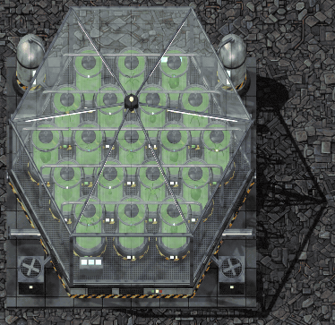
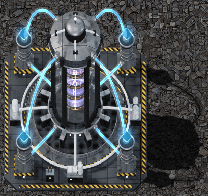

# Factorio: Beyond the Edge

Mods for **Factorio: Space Age**, extending planetary exploration, interplanetary logistics, and the post-game factory with something to build toward other than more science for its own sake.

Each mod is packaged and published separately. Space Lab and Warp Drive are available now, and Stargate has its first piece, gate construction. Two more are planned: an independent Mechanoids mod, and Homecoming Journey, a campaign requiring all four other family mods.

| Mod | Factorio name | In one line | Details |
| --- | --- | --- | --- |
| **Beyond the Edge: Space Lab** | `bte-spacelab` | Turns space platforms into self-sufficient orbital industry. | [Space Lab manual](spacelab/README.md) |
| **Beyond the Edge: Warp Drive** | `bte-warp-drive` | Turns deep-space distance into research, then into faster-than-normal platform travel. | [Warp Drive manual](warp-drive/README.md) |
| **Beyond the Edge: Mechanoids — Guardians of the Ruins** *(planned)* | `bte-mechanoids` | Mechanical ruin defenders, provisionally on Fulgora in standalone play. | [Mechanoids vision](mechanoids/VISION.md) |
| **Beyond the Edge: Stargate** *(in development)* | `bte-stargate` | A gate built from a delivery of late-game materials; travel and trains come later. | [Stargate manual](stargate/README.md) |
| **Beyond the Edge: Homecoming Journey** *(planned)* | `bte-homecoming-journey` | Combines the family into an ancient-gate campaign and a journey home. | [Homecoming vision](homecoming-journey/VISION.md) |

The collection targets Factorio 2.1 with the Space Age expansion.

## Beyond the Edge: Space Lab

<table>
  <tr>
    <th width="50%">New building: Growth Facility</th>
    <th width="50%">YouTube demo video (1.7 min)</th>
  </tr>
  <tr>
    <td align="center"></td>
    <td align="center"><a href="https://www.youtube.com/watch?v=JVCqwXjkNm8"></a></td>
  </tr>
</table>

Space Lab extends the endgame into orbit. Asteroid chunks become broad chemical feedstock, a rare new mineral unlocks high-tier chemistry, and a new Growth Facility cultivates Gleba crops and incubates eggs on the platform. The planetary science packs can be crafted in space with their standard machines, so a platform can run a complete late-game science chain on its own.

See the Space Lab manual [for all details](spacelab/README.md).

## Beyond the Edge: Warp Drive

<table>
  <tr>
    <th width="50%">New building: Warp Drive</th>
    <th width="50%">YouTube demo video (3.5 min)</th>
  </tr>
  <tr>
    <td align="center"></td>
    <td align="center"><a href="https://www.youtube.com/watch?v=FKd6wIzOH2k"></a></td>
  </tr>
</table>

Warp Drive adds one platform-only building and two technologies. At first the drive is a detector: the deeper a platform travels into space, the more it speeds up research of its own final technology. Once that research completes, the same building becomes an engine that moves the platform through subspace. It speeds up travel but does not teleport, and engine thrust, platform weight, and power still matter. Asteroids disappear in subspace, so fast travel also cuts off asteroid collection.

See the Warp Drive manual [for all details](warp-drive/README.md).

## Upcoming Mods

These are not installable yet, or only partly:

- **Mechanoids — Guardians of the Ruins:** independent robotic enemies and finite ruin encounters. Standalone placement is provisionally Fulgora-only; detailed placement and rewards remain open. [Vision](mechanoids/VISION.md) · [Plan](mechanoids/PLAN.md).
- **Stargate (the rest of it):** construction exists today; the uncontrolled first jump, controllable paired travel, and train passage do not. No enemy or campaign mod required. [Vision](stargate/VISION.md) · [Plan](stargate/PLAN.md).
- **Homecoming Journey:** requires Space Lab, Warp Drive, Mechanoids, and Stargate. It owns the ancient ruins, artifact hunt, enormous research effort, and orbital gate that brings the engineer home. [Vision](homecoming-journey/VISION.md) · [Plan](homecoming-journey/PLAN.md).

## Playing Them Together

Space Lab and Warp Drive are safe to add to an existing late-game save: they change no existing recipes or buildings (apart from Space Lab lifting the surface restriction on four science packs) and leave running factories untouched. The two mods complement each other: Space Lab makes platforms self-sufficient, and Warp Drive gives them a reason to travel deep into space. Neither mod requires the other — Warp Drive adapts its research routing depending on whether laboratories are run in space or on planets, keeping the progression engaging either way.

The planned Mechanoids mod and Stargate will also work independently, including without each other. Homecoming Journey is the deliberate exception: it brings all four together as hard dependencies. Installing Mechanoids and Stargate without Homecoming will not enable campaign rules or objectives.

## Building

Package and install the released mods into the local Factorio mod directory:

```sh
./make.sh              # every released mod
./make.sh spacelab     # one mod
```

Development rules, validation steps, and tests are described in [AGENTS.md](AGENTS.md).

Publishing copy, screenshots, and demo-video sources are grouped under [media-posts/](media-posts/README.md).

## Status

Space Lab and Warp Drive are published on the Factorio Mod Portal and are in their first public release. See each mod's **Asset Attribution** section for the origin of its art and sounds.

Mechanoids and Homecoming Journey are in planning, and Stargate is only partly built (construction), each with a separate vision and development plan linked above. Their mod identifiers are planned; none of the three has been verified in a visible game yet.

## Links

- Mod documentation:
  - [Beyond the Edge: Space Lab](spacelab/README.md)
  - [Beyond the Edge: Warp Drive](warp-drive/README.md)
  - [Beyond the Edge: Mechanoids — vision](mechanoids/VISION.md) *(planned)*
  - [Beyond the Edge: Stargate — manual](stargate/README.md) *(in development)*
  - [Beyond the Edge: Homecoming Journey — vision](homecoming-journey/VISION.md) *(planned)*
- Factorio Mod Portal:
  - [Beyond the Edge: Space Lab](https://mods.factorio.com/mod/bte-spacelab)
  - [Beyond the Edge: Warp Drive](https://mods.factorio.com/mod/bte-warp-drive)
- Release thread on the Factorio forums: <https://forums.factorio.com/viewtopic.php?t=136909>
- Reddit discussion on r/factorio: <https://www.reddit.com/r/factorio/comments/1xs3eze/the_shattered_planet_was_4000000_km_of_waiting/>
- Demo videos on YouTube:
  - [Space Lab](https://www.youtube.com/watch?v=JVCqwXjkNm8)
  - [Warp Drive](https://www.youtube.com/watch?v=FKd6wIzOH2k)
