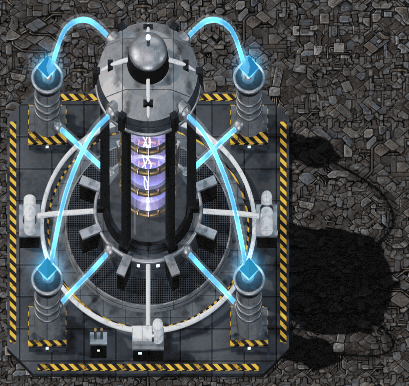

# Factorio: Beyond the Edge

Post-game mods for **Factorio: Space Age**, for factories that have already reached the Solar System Edge and want something to build toward other than more science for its own sake.

Each mod is standalone and published separately. Install either one alone, or both together.

| Mod | Factorio name | In one line | Details |
| --- | --- | --- | --- |
| SPACELAB | `bte-spacelab` | Turns space platforms into self-sufficient orbital industry. | [spacelab/README.md](spacelab/README.md) |
| Warp Drive | `bte-warp-drive` | Turns deep-space distance into research, then into faster-than-normal platform travel. | [warp-drive/README.md](warp-drive/README.md) |

Both mods require Factorio 2.1 with the Space Age expansion.

## SPACELAB

**Space Platform Asteroid Complete Extraction: Laboratories with Advanced Biotech.**

SPACELAB extends the endgame into orbit. Asteroid chunks become broad chemical feedstock, a rare new mineral unlocks high-tier chemistry, and a new Growth Facility cultivates Gleba crops and incubates eggs on the platform. The planetary science packs can be crafted in space with their standard machines, so a platform can run a complete late-game science chain on its own.

See [spacelab/README.md](spacelab/README.md) for the full design, recipes, technologies, and asset attribution.

## Warp Drive

<p align="center">
  
</p>

Warp Drive adds one platform-only building and two technologies. At first the drive is a detector: the deeper a platform travels into space, the more it speeds up research of its own final technology. Once that research completes, the same building becomes an engine that moves the platform through subspace. It speeds up travel but does not teleport, and engine thrust, platform weight, and power still matter. Asteroids disappear in subspace, so fast travel also cuts off asteroid collection.

See [warp-drive/README.md](warp-drive/README.md) for the full design, controls, formulas, technologies, and asset attribution.

## Playing Them Together

Warp Drive began as SPACELAB's final chapter and was split out so it would not require an orbital-industry overhaul. The two mods complement each other: SPACELAB makes platforms self-sufficient, and Warp Drive gives them a reason to travel deep into space. Neither mod requires the other, and Warp Drive reacts to what a platform can produce rather than checking which mods are installed.

## Building

Package and install the mods into the local Factorio mod directory:

```sh
./make.sh              # every mod
./make.sh spacelab     # one mod
```

Development rules, validation steps, and tests are described in [AGENTS.md](AGENTS.md).

## Status

Both mods are in early development. See each mod's **Asset Attribution** section for the origin of its art and sounds.
