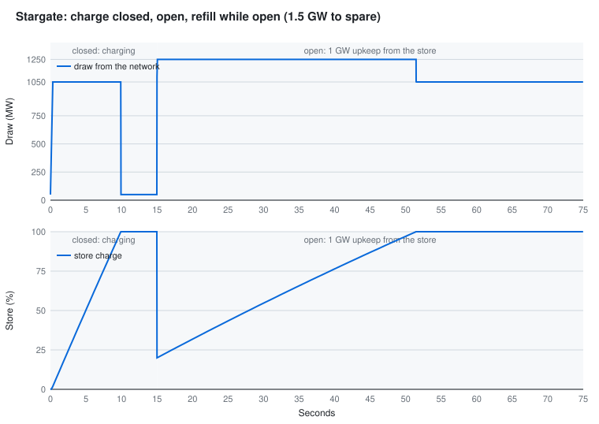
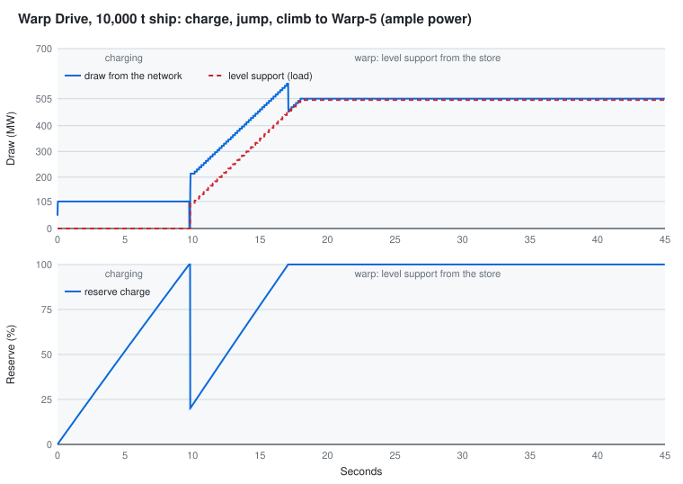
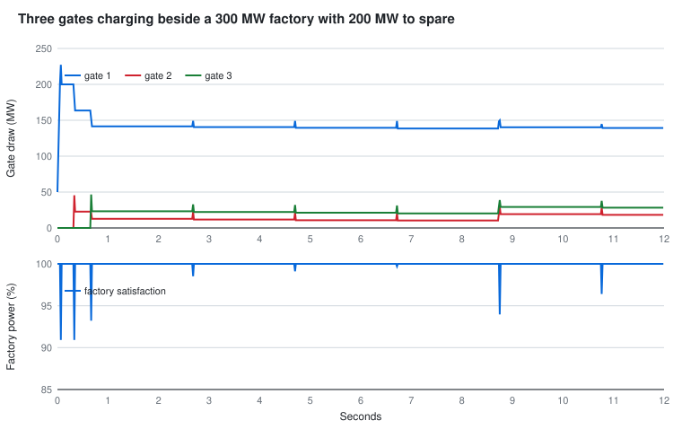

# Dynamic Power: The Power Bank

Two machines in this family need far more power than an ordinary building: the [Warp Drive](../warp-drive/README.md) and the [Stargate](../stargate/README.md). Both draw it the same way, through a **power bank**: an energy store of capacitors, charged from the electric network, which the machine runs from. This page describes how a bank charges, spends, leaks, and shares the network with the rest of your factory. Each mod's README gives its own numbers.

The code is one module, [`warp-drive/scripts/power_bank.lua`](../warp-drive/scripts/power_bank.lua). Mods cannot share code, so the Stargate carries a verbatim copy in [`stargate/scripts/power_bank.lua`](../stargate/scripts/power_bank.lua).

## The store

A bank holds up to its **capacity** $C$. It is not an accumulator: it belongs to its machine alone, never powers anything else, and does not appear as accumulator storage in the electric network window.

The store is a bank of superconducting capacitors, and like any real store it is not perfect:

- It **leaks**: it loses half a percent of its charge every second, whether the machine is running or not. Self-discharge scales with what is stored, so a full store loses the most and a nearly empty one almost nothing. (Real capacitors leak far slower; here the loss also covers the bank's cooling and containment.)

$$
P_{\mathrm{leak}} = \lambda E, \qquad \lambda = 0.005\ \mathrm{s^{-1}}
$$

Left alone, a store decays exponentially, $E(t) = E_0\,e^{-\lambda t}$: to 37 % in 200 seconds, to 5 % in 10 minutes. A machine that should stay ready keeps drawing $\lambda C$ to stay full.

Each tick ($\Delta t = 1/60$ s) the store loses the machine's running **load** $L$ (the gate's portal, the drive's warp support) and the leak, and gains its share of what the network delivered, $P_{\mathrm{in}}$:

$$
E_{t+\Delta t} = \mathrm{clamp}\Big(E_t + \big(P_{\mathrm{in}} - L - \lambda E_t\big)\,\Delta t,\ 0,\ C\Big)
$$

## Activation

A machine starts only from a **full** store, and starting spends 80 % of it. The remaining 20 % is the running reserve the load is drawn from while the network refills the store:

$$
E \geq C \quad\Longrightarrow\quad E \leftarrow (1 - \alpha)\,C, \qquad \alpha = 0.8
$$

The machine stops when the store runs dry, $E = 0$. With no power at all, the reserve right after activation lasts

$$
t_{\mathrm{cover}} = \frac{1}{\lambda}\ln\Big(1 + \frac{\lambda E}{L}\Big) \;\approx\; \frac{E}{L + \lambda E / 2}
$$

which grows as the store refills: the longer a machine has been running on ample power, the longer it rides out an outage.

## How much it draws

A bank never asks for more than

$$
P_{\max} = L + \lambda C + R
$$

where $R$ is its **refill** allowance: how fast it may charge the store beyond covering the load and the leak of a full store. It also never asks for more than the store can take, so a full bank draws exactly $L + \lambda C$.

| | Stargate | Warp Drive (ship of mass $m$) |
| --- | --- | --- |
| Capacity $C$ | `10 GJ` | $m \cdot 100\ \mathrm{J/kg}$ |
| Leak when full, $\lambda C$ | `50 MW` | $m \cdot 0.5\ \mathrm{W/kg}$ |
| Kept full, idle | `50 MW` | — |
| Charging (closed / engaged), $L = 0$ | $R$ = `1 GW`: draws up to `1.05 GW` | $R = m \cdot 10\ \mathrm{W/kg}$: draws up to $m \cdot 10.5\ \mathrm{W/kg}$ |
| Activation spends | `8 GJ` (80 %), leaving `2 GJ` | $m \cdot 80\ \mathrm{J/kg}$, leaving $m \cdot 20\ \mathrm{J/kg}$ |
| Running load $L$ | `1 GW` (open portal) | $m \cdot 10\ \mathrm{W/kg}$ per warp level |
| Running refill $R$ | `200 MW`: draws up to `1.25 GW` | $m \cdot 10\ \mathrm{W/kg}$, plus the next level's support while climbing |
| Running, store full | `1.05 GW` | $(\ell \cdot 10 + 0.5)\,m\ \mathrm{W/kg}$ at level $\ell$ |

With enough spare power the store fills at $P_{\max} - L - \lambda E$ net, so from empty it takes $\frac{1}{\lambda}\ln\frac{R + \lambda C}{R} \approx 9.8$ seconds for both machines. After activation the running refill restores what was spent in about 37 seconds for the gate and 8 for the drive.

The gate above charges closed at `1.05 GW`, then is held closed for a few seconds with **Keep charged when deactivated**, full and drawing only `50 MW` to cover its leak. It opens at 15 s: the store drops to `2 GJ`, and the gate draws `1.25 GW` (the `1 GW` upkeep, the leak, and `200 MW` of refill) until the store is full again, then `1.05 GW`.

The drive above is on a `10,000 t` ship: it charges its `1 GJ` reserve at `105 MW`, jumps, and climbs half a level a second to Warp-5. While it climbs it draws the next level's support plus the refill, so the reserve is full again by the time it reaches Warp-5. From then on it draws `505 MW`: `500 MW` of support and the `5 MW` leak.

## Sharing the network

A bank is an ordinary machine on the electric network. When a network cannot supply everyone, Factorio gives every machine the same fraction of what it asks for, so a bank that asked for its full $P_{\max}$ at once would slow every assembler in the factory. A bank therefore never asks for its maximum outright: it **adapts** its request $Q$ to what the network can spare.

Each tick it compares what arrived, $P_{\mathrm{in}}$, with what it asked for:

- **Fully met** ($P_{\mathrm{in}} \geq 0.999\,Q$): ask for more next tick, by a step $s$ that grows with every success, from `10 MW` up to `50 MW`:

$$
Q \leftarrow Q + s, \qquad s \leftarrow \min(1.1\,s,\ 50\ \mathrm{MW})
$$

- **Short:** the network was overloaded. Back off below what arrived, by the step or twice the shortfall, whichever is more, but never below half of what arrived. Reset the step to `10 MW` and hold for two seconds before asking for more:

$$
Q \leftarrow \max\Big(\tfrac{1}{2}P_{\mathrm{in}},\ \min\big(P_{\mathrm{in}},\ Q - \max(s,\ 2\,(Q - P_{\mathrm{in}}))\big)\Big), \qquad s \leftarrow 10\ \mathrm{MW}
$$

The factory loses power in the same proportion as the bank, so backing off by twice the bank's own shortfall ends the factory's dip sooner. The hold keeps the bank from pushing at the limit every tick; it probes again every two seconds, in small steps. When nothing arrived at all there is nobody to protect, so there is no hold.

- **Starting:** activation resets the step to `50 MW`, so a gate or drive that sat full on its small leak top-up climbs quickly to its running load. The reserve covers the climb.

The bank asks for $\min(Q,\ P_{\max})$, also capped by what the store can take. It only raises $Q$ when it asked for all of it, so a bank capped by a full store does not learn a request it never tested.

Above, three gates switch on a third of a second apart beside a `300 MW` factory with `200 MW` to spare. Each start dips the factory for a tick or two; afterwards the gates settle under the spare power and the factory keeps its power, with a brief dip every two seconds when one of them probes. The first gate keeps the larger share: banks back off in proportion to what they draw, so they even out only slowly. The gates' total stays close to the spare power, which is what matters to the factory.

### Measured

[`stargate/tests/power-model.py`](../stargate/tests/power-model.py) simulates the sharing rule over 30 seconds, comparing this policy with a fixed `50 MW` step and a one-second hold that it replaced:

| Case | Factory energy lost, fixed → adaptive | Share of spare power used, fixed → adaptive |
| --- | --- | --- |
| `300 MW` factory, `100 MW` spare, 1 gate | 11.7 → 1.7 MJ | 84 → 95 % |
| `300 MW` factory, `200 MW` spare, 1 gate | 6.1 → 1.3 MJ | 81 → 97 % |
| `300 MW` factory, `300 MW` spare, 1 gate | 6.5 → 1.0 MJ | 90 → 99 % |
| `300 MW` factory, `100 MW` spare, 3 gates | 32.4 → 4.0 MJ | 54 → 78 % |
| `300 MW` factory, `200 MW` spare, 3 gates | 12.3 → 3.0 MJ | 47 → 89 % |
| `300 MW` factory, `300 MW` spare, 3 gates | 7.3 → 2.5 MJ | 60 → 92 % |
| `3 GW` factory, `1 GW` spare, 3 gates | 40.8 → 4.1 MJ | 94 → 98 % |

The Stargate's runtime test runs the hardest case, three gates sharing `100 MW`, in the game itself: the factory keeps 99.97 % of its power and the gates take about 80 % of the spare.

## Steady draw

A bank whose store is full and that the network has fed in full for five seconds needs only a steady draw: its load and its leak. It then hands that draw to the game, which takes it every tick with no script running, and the mod checks once a second, from the network's power statistics (the figures the power screen shows), that the bank's interfaces got all of it. If they did not, the missing energy comes out of the store and the bank returns to asking tick by tick, as above; any change of load or limit (opening, closing, switching off, a full store being spent) does the same. So a shortage costs a bank up to one second at its full steady draw before it backs off, and costs no script time at all while there is none.

## Things to know

- **Spare means spare generation, and accumulators count.** A bank is an ordinary machine, so when generators fall short, accumulators discharge into it as into any assembler, until they run empty. A gate held open on an accumulator bank drains it.
- **Steam engines, turbines, and reactors** produce only what is used, so their idle capacity is spare: a bank makes them work harder, but the factory still gets everything it asks for. Solar panels count only what they make beyond the factory's use.
- **A bank settles a little below an exact limit.** Probing finds the edge, backs off, and waits, so on a network with exactly `200 MW` to spare a bank averages about `190 MW`.
- **Banks start in order of arrival.** Several banks on one network share its spare power, but not evenly: whichever started first keeps the larger share.

## For maintainers

- The store is in script storage. Factorio counts a tertiary interface's buffer as accumulator storage, so the hidden interface is an ordinary `secondary-input` consumer whose buffer holds one tick of the current request and is emptied into the store every tick. With a larger buffer emptied less often, `input_flow_limit` did not hold back the refill, which took several ticks' worth in one tick and dipped the network each time.
- Interface modes and buffer sizes are saved per entity and survive prototype changes, so `PowerBank.tick` verifies them on the first tick after load or reset and then updates `input_flow_limit` and `electric_buffer_size` only when `applied` changes.
- Asking for the network's measured spare generation (`LuaElectricNetwork.flow_last_tick`) instead of probing was tried and reverted: every bank on a network sees the same spare at once, and several of them oscillated.
- Test fixtures that supply "exactly" some power with an `electric-energy-interface` must give it a buffer of one tick of output. A larger buffer stores whatever a backing-off bank leaves unused, then releases it all at once, above the intended limit.
- Steady draw: the interface's `power_usage` is the need and its buffer one tick of it, and `PowerBank.expected` (what the bank believes it drew, exact while ticked) summed over a network is compared with the change in that network's `get_input_count(<interface prototype>)` via `unit.electric_network.parent_network.statistics`, which is in joules and matched the banks' own sums to a few joules in 846 MJ. Both the Stargate (`Gate.check_power`) and the Warp Drive (`Warp.check_power` for steady `1 GW` `sink` detectors and 10-tick checks during steady warp) use direct mode so settled gates and drives leave the `on_tick` loop completely.
- Change the module in Warp Drive, copy it to the Stargate, and keep the charts current: `python3 tools/power-charts.py` regenerates [`docs/power/`](power/) from the same rules.
