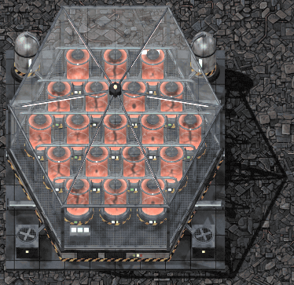

# Mod Portal entry: Beyond the Edge: Space Lab

Fields to enter at https://mods.factorio.com when uploading `bte-spacelab_<version>.zip`. Name, title, version, and dependencies come from `info.json`.

| Field | Value |
| --- | --- |
| Summary | Run a complete late-game science chain in orbit: asteroid stone, ammonia, lithium, fluorine, holmium and tungsten, a new Growth Facility for Gleba crops and eggs, and all four planetary science packs made on your platform. |
| Category | Content |
| Tags | Planets, Manufacturing, Mining, Fluids |
| License | MIT |
| Source URL | https://github.com/megaboich/factorio-beyond-the-edge/tree/main/spacelab |
| Homepage | https://github.com/megaboich/factorio-beyond-the-edge |
| Thumbnail | `spacelab/thumbnail.png` (also inside the zip) |
| Gallery | `gallery/*.jpg`, in file-name order |

## Description

Paste everything below the line into the Description field (Markdown).

---

**Your research ship never needs to come home.**

Once your factory reaches the Solar System Edge, platforms still rely on planet-side rockets for stone, ammonia, lithium, Gleba crops, eggs and planetary science. Space Lab removes that tether and lets one platform run a complete late-game science chain on its own.

### What it adds

- **Asteroid chemistry:** new Crusher and Cryogenic Plant recipes recover stone, ammonia, lithium brine, fluorine and trace uranium from ordinary asteroid chunks.
- **Flurolite:** a rare new mineral from asteroid chunks that feeds high-tier chemistry.
- **Shattered Synthesis:** turns promethium chunks into tungsten and holmium ore.
- **Growth Facility:** a 9x9 orbital bio-lab. One seed grows 57 Yumako or Jellynut, and one biter or pentapod egg becomes 19. Nothing spoils while it stays inside.
- **Science in orbit:** agricultural, cryogenic, electromagnetic and metallurgic science packs can be crafted on space platforms with their usual machines.

Three technologies unlock it all: **Asteroid Stone Processing**, **Flurolite Processing** and **Growth Facility**.

### Demo video

[Watch the 1.7-minute demo on YouTube](https://www.youtube.com/watch?v=JVCqwXjkNm8)

### Full manual

Recipes, yields, technology costs and balance values are in the manual on GitHub:
https://github.com/megaboich/factorio-beyond-the-edge/tree/main/spacelab

### Compatibility

- Requires Factorio 2.1 with Space Age.
- Standalone. Works well with its companion mod [Beyond the Edge: Warp Drive](https://mods.factorio.com/mod/bte-warp-drive).
- Changes only the surface conditions of the four planetary science pack recipes; all other vanilla content is untouched.

Bug reports and ideas are welcome on [GitHub Issues](https://github.com/megaboich/factorio-beyond-the-edge/issues) or the Discussion tab.
