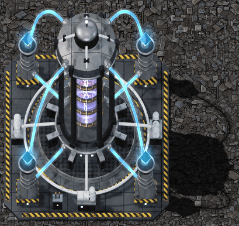

# Mod Portal entry: Beyond the Edge: Warp Drive

Fields to enter at https://mods.factorio.com when uploading `bte-warp-drive_<version>.zip`. Name, title, version, and dependencies come from `info.json`. Publish Space Lab first, because this mod lists it as an optional dependency.

| Field | Value |
| --- | --- |
| Summary | Tired of crawling to the Shattered Planet? Research a Warp Drive with deep-space tachyons, then jump your platform into subspace: no asteroids, and many times the speed on the long route out and back. |
| Category | Content |
| Tags | Planets, Transportation, Circuit network, Power |
| License | MIT |
| Source URL | https://github.com/megaboich/factorio-beyond-the-edge/tree/main/warp-drive |
| Homepage | https://github.com/megaboich/factorio-beyond-the-edge |
| Thumbnail | `warp-drive/thumbnail.png` (also inside the zip) |
| Gallery | `gallery/*.jpg`, in file-name order |

## Description

Paste everything below the line into the Description field (Markdown).

---

**The Shattered Planet is 4,000,000 km away. Stop waiting.**

The deeper your platforms go, the denser the asteroids and the slower the trip. Warp Drive turns that distance into research, then the research into speed.

### How it works

- **Tachyon detector:** build the Warp Drive on a platform and it observes subspace tachyons. Their signal grows stronger the further you fly into deep space, and it speeds up research of the enormously expensive **Practical Warp Drive**.
- **Warp travel:** once researched, the same building charges up and breaches subspace with a shockwave. At warp the platform travels 10 times faster or more, climbing warp levels as engine speed and power allow, and asteroids cannot reach it.
- **The trade-off:** no asteroids also means no raw materials. Long flights become an automation puzzle: warp, drop out, collect, repeat.
- **Circuit control:** engage and disengage warp, or run the detector, from circuit conditions, and read warp telemetry signals.
- **Science boost:** after research, the detector boosts science in onboard labs, or remotely in planetary labs.

Thrusters, fuel, platform weight and power generation all still matter. Warp is faster travel, not teleportation. One Warp Drive per platform.

### Demo video

[Watch the 3.5-minute demo on YouTube](https://www.youtube.com/watch?v=FKd6wIzOH2k)

### Full manual

Technology costs, energy formulas, circuit signals and tuning tips are in the manual on GitHub:
https://github.com/megaboich/factorio-beyond-the-edge/tree/main/warp-drive

### Compatibility

- Requires Factorio 2.1 with Space Age.
- Standalone. Pairs well with [Beyond the Edge: Space Lab](https://mods.factorio.com/mod/bte-spacelab) for a fully self-sufficient research ship.
- Adds no new labs, science packs or items besides the drive itself.

Bug reports and ideas are welcome on [GitHub Issues](https://github.com/megaboich/factorio-beyond-the-edge/issues) or the Discussion tab.
