# Beyond the Edge: Space Lab

**Beyond the Edge: Space Lab** is a standalone Factorio: Space Age post-game mod. It adds one advanced orbital biotechnology building ( **Growth Facility**), one trace asteroid mineral ( **Flurolite**), three post-game technologies (**Asteroid Stone Processing**, **Flurolite Processing**, and **Growth Facility**), and surface-condition overrides that let a space platform craft every planetary science pack in orbit.

### Demo video on YouTube (1.7 min)

The mod requires `base >= 2.1.0` and `space-age >= 2.1.0`. [Beyond the Edge: Warp Drive](../warp-drive/README.md) is optional.

Safe to add to an existing late-game save: the mod only adds new recipes, technologies, and a building. The one vanilla change removes the surface conditions from four science pack recipes, which only allows more, so existing factories keep running exactly as before.

## Overview

Once a Space Age factory reaches the Solar System Edge, planetary production is established, but space platforms still depend on planet-side rockets for stone, ammonia, lithium, fluorine, Gleba crops, eggs, and the four planetary science packs.

Space Lab turns a space platform into a self-sufficient orbital factory:

- **Complete asteroid extraction:** New Crusher and Cryogenic Plant recipes recover bulk  Stone, 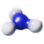 Ammonia,  Flurolite, 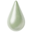 Lithium Brine,  Fluorine,  Holmium Ore,  Tungsten Ore, and trace  Uranium Ore directly from asteroid chunks.
- **Orbital biotechnology:** The  **Growth Facility** cultivates  Yumako and  Jellynut from seeds and incubates  Biter Eggs and  Pentapod Eggs in orbit while preserving products inside its output inventory.
- **Orbital science production:** Planetary surface conditions are removed from the  Agricultural,  Cryogenic,  Electromagnetic, and  Metallurgic Science Pack recipes, so standard machines can run the entire late-game science chain on a space platform.

## Building, Material & Technologies

 **Growth Facility:** A `9x9`, `100 MW` orbital biotechnology facility with crafting speed `4`, `8` module slots restricted to consumption (efficiency) effects, and `3` west/east pass-through fluid lanes. One facility weighs `1,000 kg` (one standard cargo rocket load). Its nineteen cloning tanks display the active biological cycle and preserve finished products in the machine output until removed:

| Yumako cultivation | Jellynut cultivation |
| --- | --- |
| 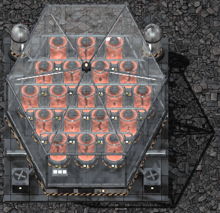 | 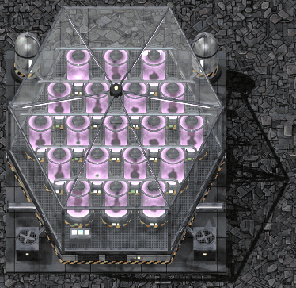 |
| **Biter egg incubation** | **Pentapod egg incubation** |
| 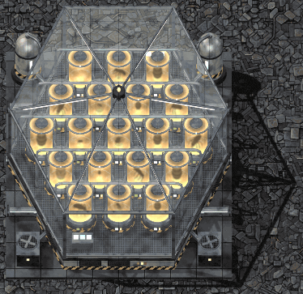 | 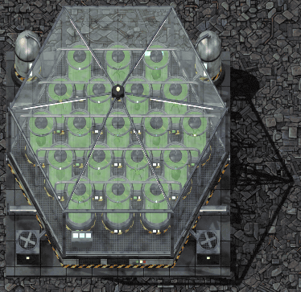 |

- **Yumako cultivation:** Grows  `57` Yumako from a single  Yumako Seed over `60s` using orbital water, steam, ammonia, calcite, carbon, and nutrients.
- **Jellynut cultivation:** Grows  `57` Jellynut from a single  Jellynut Seed over `60s`, pairing with Yumako to sustain a closed-loop Bioflux and Nutrients chain in space.
- **Biter egg incubation:** Incubates `1`  Biter Egg into `19`  Biter Eggs over `120s` with Bioflux enrichment and life-support fluids, keeping eggs preserved while stored in the machine output.
- **Pentapod egg incubation:** Incubates `1`  Pentapod Egg into `19`  Pentapod Eggs over `120s`, supplying orbital Biochambers with fresh eggs for Agricultural Science Packs.

The **Growth Facility** takes `10s` to craft from:

-  1 Cryogenic Plant
-  40 Low Density Structures
-  4 Pumps
-  1 Heat Exchanger
-  100 Small Lamps
-  100 Refined Concrete
-  50 Overgrowth Yumako Soil
-  50 Overgrowth Jellynut Soil

 **Flurolite (Fluoro-Spodumene):** A rare trace mineral recovered only as a byproduct of advanced asteroid crushing (with no mineable patches or planetary autoplace). Steam condensation in a  Cryogenic Plant splits Flurolite into  Lithium Brine and  Fluorine.

| Technology | Cost | Unlock |
| --- | --- | --- |
| 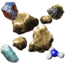 **Asteroid Stone Processing** | `1,200` units at 120 seconds each | Unlocks **Metallic Crushing (Stone-Focused)**, **Carbonic Crushing (Stone-Focused)**, and **Oxide Crushing (Stone-Focused)** in the  Crusher for bulk orbital  Stone recovery, plus **Ammonia Extraction** in the  Cryogenic Plant to synthesize  Ammonia from Stone, Water, and Steam. |
| 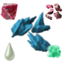 **Flurolite Processing** | `1,200` units at 120 seconds each | Unlocks **Metallic Crushing (Flurolite-Focused)**, **Carbonic Crushing (Flurolite-Focused)**, and **Oxide Crushing (Flurolite-Focused)** for trace  Flurolite and  Uranium Ore recovery, **Shattered Synthesis** for processing  Promethium Asteroid Chunks into  Holmium Ore and  Tungsten Ore, and **Lithium-Focused Condensation** and **Fluorine-Focused Condensation** in the  Cryogenic Plant. |
|  **Growth Facility** | `1,200` units at 120 seconds each | Unlocks the  **Growth Facility** building and all four orbital biology recipes: **Yumako Cultivation**, **Jellynut Cultivation**, **Biter Egg Incubation**, and **Pentapod Egg Incubation**. |

All three technologies require  **Promethium Science Pack** and consume the full late-game set of 12 science packs:  Automation,  Logistic,  Military,  Chemical,  Production,  Utility,  Space,  Metallurgic,  Electromagnetic,  Agricultural,  Cryogenic, and  Promethium.

## Asteroid Extraction & Cryogenic Chemistry

Vanilla asteroid crushing never produces  Stone. Space Lab adds two crushing tiers for the three common asteroid chunks ( Metallic,  Carbonic, and 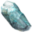 Oxide), plus a dedicated recipe for  Promethium Asteroid Chunks (**Red Asteroids**):

- **Stone-Focused crushing** (**Asteroid Stone Processing**): Fast `2s` recipes that yield `4`  Stone alongside the chunk's primary resource (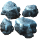 Iron /  Copper,  Carbon, or  Ice).
- **Flurolite-Focused crushing** (**Flurolite Processing**): `3s` recipes that trade half the Stone (`2`  Stone) for independent rolls of `5%`  Flurolite and `1%`  Uranium Ore. ( Calcite remains on vanilla advanced Oxide crushing.)
- **Shattered Synthesis** (**Flurolite Processing**): Crushes  Promethium Asteroid Chunks in `4s` into guaranteed  Tungsten Ore and  Stone, plus `20%`  Holmium Ore, `5%`  Flurolite, and `3%`  Uranium Ore.

### Crusher Recipes

| Recipe | Time | Ingredients | Outputs | Notes |
| --- | --- | --- | --- | --- |
| **Metallic Crushing (Stone-Focused)** | 2s |  1 Metallic Asteroid Chunk |  1 Iron Ore,  1 Copper Ore,  4 Stone | Bulk orbital Stone alongside Iron and Copper Ore. |
| **Carbonic Crushing (Stone-Focused)** | 2s |  1 Carbonic Asteroid Chunk |  2 Carbon,  4 Stone | Primary Carbon and Stone feedstock for Ammonia Extraction. |
| **Oxide Crushing (Stone-Focused)** | 2s |  1 Oxide Asteroid Chunk |  2 Ice,  4 Stone | Supplements platform water supply while yielding bulk Stone. |
| **Metallic Crushing (Flurolite-Focused)** | 3s |  1 Metallic Asteroid Chunk |  1 Iron Ore,  1 Copper Ore,  2 Stone,  5% chance for 1 Flurolite,  1% chance for 1 Uranium Ore | Trades half the Stone yield for trace Flurolite and Uranium Ore rolls. |
| **Carbonic Crushing (Flurolite-Focused)** | 3s |  1 Carbonic Asteroid Chunk |  2 Carbon,  2 Stone,  5% chance for 1 Flurolite,  1% chance for 1 Uranium Ore | Retains full Carbon output while adding trace Flurolite and Uranium Ore rolls. |
| **Oxide Crushing (Flurolite-Focused)** | 3s |  1 Oxide Asteroid Chunk |  2 Ice,  2 Stone,  5% chance for 1 Flurolite,  1% chance for 1 Uranium Ore | Retains full Ice output while adding trace Flurolite and Uranium Ore rolls. |
| **Shattered Synthesis** | 4s |  1 Promethium Asteroid Chunk |  20% chance for 1 Holmium Ore,  1 Tungsten Ore,  2 Stone,  5% chance for 1 Flurolite,  3% chance for 1 Uranium Ore | Deep-space source of Holmium and Tungsten outside planetary mining, with the highest Uranium Ore chance. |

### Cryogenic Plant Recipes

All three chemical processing recipes run in the standard  **Cryogenic Plant** and support productivity:

| Recipe | Time | Ingredients | Outputs | Notes |
| --- | --- | --- | --- | --- |
| **Ammonia Extraction** | 5s |  5 Stone,  100 Water,  50 Steam |  10 Ammonia | Synthesizes Ammonia from crushed asteroid Stone, Water, and Steam without importing from Aquilo. |
| **Lithium-Focused Condensation** | 10s |  1 Flurolite,  100 Steam |  40 Lithium Brine,  10 Fluorine | Favors Lithium Brine (`4:1` over Fluorine); pair with Fluorine-Focused Condensation via circuit control to balance both fluids. |
| **Fluorine-Focused Condensation** | 10s |  1 Flurolite,  100 Steam |  40 Fluorine,  10 Lithium Brine | Mirror recipe favoring Fluorine (`4:1` over Lithium Brine). |

## Orbital Biotechnology

Unlocked by **Growth Facility**, all four biological recipes run exclusively in the  **Growth Facility**, support productivity, and preserve their spoilable outputs inside the machine's output slots:

| Recipe | Time | Ingredients | Outputs | Notes |
| --- | --- | --- | --- | --- |
| **Yumako Cultivation** | 60s | 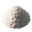 25 Nutrients,  500 Water,  250 Steam,  1 Yumako Seed,  5 Calcite,  10 Carbon,  125 Ammonia |  57 Yumako | Preserves harvested Yumako in the machine output until inserted into downstream processing. |
| **Jellynut Cultivation** | 60s |  25 Nutrients,  500 Water,  250 Steam,  1 Jellynut Seed,  5 Calcite,  10 Carbon,  125 Ammonia |  57 Jellynut | Paired with Yumako Cultivation to feed orbital Bioflux and Nutrients loops. |
| **Biter Egg Incubation** | 120s |  50 Nutrients,  5 Bioflux,  500 Water,  250 Steam,  1 Biter Egg,  5 Calcite,  10 Carbon,  125 Ammonia |  19 Biter Eggs | Multiplies Biter Eggs in orbit for  Promethium Science Pack production without Nauvis shipments. |
| **Pentapod Egg Incubation** | 120s |  50 Nutrients,  5 Bioflux,  500 Water,  250 Steam,  1 Pentapod Egg,  5 Calcite,  10 Carbon,  125 Ammonia |  19 Pentapod Eggs | Multiplies Pentapod Eggs in orbit for  Agricultural Science Pack and Biochamber production. |

## Orbital Science Production

To let a platform convert its orbital resources into a complete science chain without adding duplicate recipes or custom machines, Space Lab removes the planetary surface conditions from the four Space Age planetary science pack recipes (leaving their ingredients, crafting times, machines, productivity support, and technology unlocks untouched):

| Science Pack | Machine | Surface Condition Removed | Unchanged Recipe |
| --- | --- | --- | --- |
|  Agricultural Science Pack |  Biochamber | `pressure = 2000` (Gleba) | `4s`:  1 Bioflux +  1 Pentapod Egg → 1 pack |
|  Cryogenic Science Pack |  Cryogenic Plant | `pressure = 300` (Aquilo) | `20s`: standard Cryogenics recipe, outputs, and hot Fluoroketone return |
|  Electromagnetic Science Pack |  Electromagnetic Plant | `magnetic-field = 99` (Fulgora) | `10s`: standard Electromagnetics recipe and outputs |
|  Metallurgic Science Pack |  Foundry | `pressure = 4000` (Vulcanus) | `10s`:  3 Tungsten Carbide + 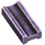 2 Tungsten Plates +  200 Molten Copper → 1 pack |

When played alongside [Beyond the Edge: Warp Drive](../warp-drive/README.md), producing all 12 science packs directly in orbit lets you run laboratories on the detector platform itself and receive `100%` of the **Practical Warp Drive** tachyon signal without the `10x` remote planetary transfer loss.

## Scientific Justification

- **Ammonia from Stone:** Carbonaceous asteroids contain nitrogen-bearing phyllosilicates. A Cryogenic Plant uses high-pressure and heat processing to extract ammonia directly from stone.
- **Stone from Crushing:** Vanilla asteroid processing never yields Stone, but mechanical shattering of any silicate or metallic body inherently produces mineral rubble regardless of composition. The Stone-Focused Crusher variants isolate that rubble without the finer sieving needed to detect Flurolite traces, which is why they are the cheaper, faster option.
- **Flurolite Chemistry:** Lithium and fluorine are geochemically linked in evolved crustal granites. Flurolite represents the trace rare-earth inclusions found within shattered planetary crusts, processed through cryogenic plant distillation. Red Asteroids carry the richest concentration, but trace inclusions also turn up in ordinary Metallic, Carbonic, and Oxide chunks; finding them requires the finer sieving of the Flurolite-Focused Crusher variants, at the cost of some Stone throughput. Calcite recovery is left untouched on the existing Oxide processing recipe, which already yields it in ample quantity.
- **Uranium Trace Recovery:** Uranium Ore appears as a rare heavy-element inclusion in the same advanced asteroid separation step that detects Flurolite. Common asteroid chunks only expose tiny recoverable traces, while Red Asteroids justify a higher recovery chance because their heavy-metal profile is already represented by Holmium and Tungsten outputs.
- **Growth Facility:** Rather than "stabilizing" life, the Growth Facility provides the precise environmental parameters — heat, light, nutrients, Bioflux enrichment, nitrogen atmosphere, calcite buffering, carbon feedstock, and high-energy water hydrolysis for oxygen supply — required to maintain planetary species in a low-gravity environment while keeping the high-stakes spoilage mechanics of Space Age intact. Yumako and Jellynut are cultivated from their corresponding seeds as a matched pair, exactly as they grow together on Gleba, while Biter and Pentapod eggs require separate incubation recipes so the platform's Bioflux, Nutrients, and egg chains stay self-sufficient.

## Asset Attribution

The Growth Facility building graphics (animation, shadow, per-recipe tank contents, and lights), its item icon, and the main layer of its technology icon are original art, rendered from Three.js models in this repository (`tools/sprites/models/growth-facility.js`, `growth-facility-icon.js`, and `growth-facility-technology.js`).

Flurolite uses tinted Space Age calcite icons at runtime, and technology icons layer vanilla item and fluid icons; neither bundles any copied graphics. The item, fluid, building, and technology icons in this README are extracted from Factorio and this mod by `tools/readme-icons.py` and are not part of the mod package.
