# Factorio SPACELAB Mod

  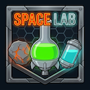

**SPACELAB** stands for **Space Platform Asteroid Complete Extraction: Laboratories with Advanced Biotech**.

An end-game extension mod for **Factorio: Space Age** that prolongs the endgame with complete asteroid extraction, orbital laboratories, and advanced biotech challenges once the Solar System Edge is behind you.

## Prequel: Beyond the Plateau

Space Age already delivers a complete arc, from first orbital logistics to the Solar System Edge. SPACELAB starts after that arc, where the factory can keep expanding into a new kind of goal instead of only repeating its final optimization loop.

The main motivation is the point where upgrades risk becoming **meaningless: productivity of producing science, in service of producing more science.** SPACELAB turns that momentum toward alternative possibilities: asteroid-based chemistry, orbital biological systems, and a space platform that becomes a new production frontier rather than only a launch destination.

## Overview

SPACELAB is a high-tier industrial expansion for building a self-sufficient orbital industry. It uses asteroid debris as broad chemical feedstock and adds advanced Growth Facility recipes so space platforms can support complex material, agricultural, and biological chains.

Instead of replacing the existing journey, SPACELAB extends it with future-facing infrastructure: complete asteroid extraction, high-energy synthesis, orbital cultivation, and closed-loop production that gives late-game factories new systems to design, balance, and scale.

## Design Philosophy

- **Mostly Additive & Compatible:** New content is gated behind high-tier research. The only vanilla recipe overrides remove planetary surface conditions from Agricultural, Cryogenic, Electromagnetic, and Metallurgic Science Packs so their standard machines can craft them on space platforms; their ingredients, times, categories, productivity, and unlocks are unchanged.
- **Logistics Mastery:** The mod replaces "planetary dependency" with "orbital complexity." Production chains are energy-intensive and require advanced circuit-logic balancing.
- **Closed-Loop Economy:** By extracting rare chemical inputs from asteroid debris, you turn your platform into a self-sustaining ecosystem.

## Core Features

### New Materials

-  **Flurolite (Fluoro-Spodumene):** A rare, trace mineral found only as a byproduct of asteroid processing. It has no mineable resource patches or autoplace and is the mandatory precursor for high-tier chemical synthesis. Its current icon uses sky-blue-tinted Space Age calcite crystal artwork.

### Asteroid Feedstock

Not all asteroid chunks are created equal. SPACELAB distinguishes between three common feedstock types and one rare one, all processed through the Crusher in increasing order of required tech:

-  **Metallic Asteroid:** The most common chunk type, dense with iron and copper ore. New Crusher tech extracts bulk Stone from it directly, while a separate Flurolite tier adds rare chances at Flurolite and Uranium Ore.
-  **Carbonic Asteroid:** Rich in carbon compounds, these chunks are the platform's primary carbon feedstock. It has the same Stone-Focused and Flurolite-Focused alternatives as Metallic, including a trace Uranium Ore roll in the advanced recipe.
- 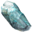 **Oxide Asteroid:** Ice-bearing chunks that supplement on-platform water production. It has the same Stone-Focused and Flurolite-Focused alternatives as Metallic, including a trace Uranium Ore roll in the advanced recipe.
-  **Red Asteroid:** A rare, high-value chunk laced with heavy trace metals, requiring the most advanced Crusher tech. Its "Shattered Synthesis" processing is the single richest source of Holmium and Tungsten outside of Aquilo mining, alongside the best per-chunk Flurolite and Uranium Ore odds.

These three common types share a two-tier recipe progression:

- **Stone-Focused** (early, cheap tech): maximizes raw Stone recovery alongside the base ore. Useful the moment a platform needs Stone at all, since vanilla asteroid processing never yields it, and it doesn't require unlocking Flurolite tech.
- **Flurolite-Focused** (advanced independent tech): trades some Stone yield for trace chances at Flurolite and Uranium Ore, giving platforms far from a Red Asteroid field alternate rare-material rolls once they need them.

Calcite is left to existing Oxide asteroid processing, which already produces it in ample quantity.

### New Buildings

-  **Growth Facility:** A 9x9, 100 MW advanced facility with crafting speed 4, eight module slots restricted to consumption effects, and three west/east fluid pass-through lanes. It cultivates Gleba's two staple crops, **Yumako Fruit** and **Jellynut**, and separately incubates Biter and Pentapod eggs in orbit. One facility weighs 1,000 kg, so exactly one fits in a standard cargo rocket. It is a hexagonal glass hall over nineteen cloning tanks of glowing, cloudy, bubbling fluid. The tanks show what the current recipe grows, at every life stage at once: Yumako trees, Jellystems bearing Jellynut pods, hatching Biters, or hatching Pentapods.

| Yumako cultivation | Jellynut cultivation |
| --- | --- |
| 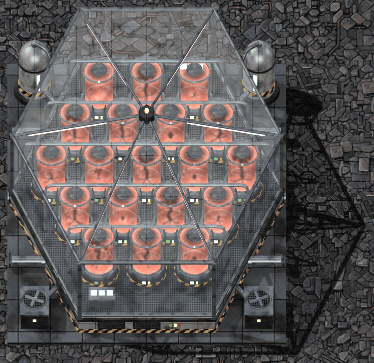 | 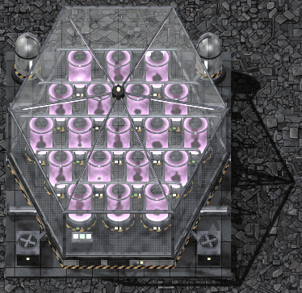 |
| **Biter egg incubation** | **Pentapod egg incubation** |
| 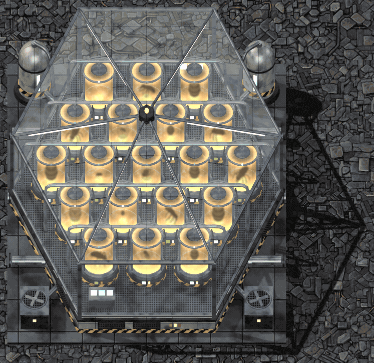 | 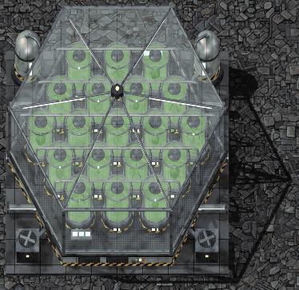 |

### Existing Building Integration

-  **Crusher:** Now processes Metallic, Carbonic, and Oxide asteroid chunks, each with a Stone-Focused and a Flurolite-Focused recipe variant, before Red Asteroid shattering ("Shattered Synthesis") unlocks as the top tier with stronger rare byproduct odds, including Uranium Ore.
-  **Cryogenic Plant:** Handles ammonia extraction, lithium-focused condensation, and fluorine-focused condensation without introducing additional dedicated processing buildings. Cryogenic Science Pack no longer requires Aquilo's pressure and can therefore be crafted on a space platform.
-  **Electromagnetic Plant:** Electromagnetic Science Pack no longer requires Fulgora's magnetic field and can therefore be crafted on a space platform.
-  **Biochamber:** Retains its standard Organic recipes and behavior, but Agricultural Science Pack no longer requires Gleba's pressure and can therefore be crafted in a Biochamber on a space platform. No duplicate science recipe or additional machine is added.
-  **Foundry:** Retains its standard Metallurgy recipes and behavior, but Metallurgic Science Pack no longer requires Vulcanus's pressure and can therefore be crafted in a Foundry on a space platform. No duplicate science recipe or additional machine is added.

## Technologies

All SPACELAB technologies are post-Solar System Edge research gated behind  **Promethium Science Pack**. Each technology costs **1,200 research units**, takes **120 seconds per unit**, and requires the full late-game science set:  Automation,  Logistic,  Military,  Chemical,  Production,  Utility,  Space,  Metallurgic,  Electromagnetic,  Agricultural,  Cryogenic, and  Promethium science packs.

| Technology | Requires | Unlocks | Purpose |
| --- | --- | --- | --- |
| 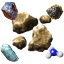 Asteroid Stone Processing |  Promethium Science Pack; full late-game science set | Metallic, Carbonic, and Oxide Stone-Focused asteroid crushing; Ammonia Extraction | First SPACELAB tier for bulk orbital Stone recovery and Stone-to-Ammonia chemistry. |
| 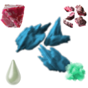 Flurolite Processing |  Promethium Science Pack; full late-game science set | Metallic, Carbonic, and Oxide Flurolite-Focused asteroid crushing; Shattered Synthesis; Lithium-Focused Condensation; Fluorine-Focused Condensation | Advanced rare-material tier for Flurolite recovery, Red Asteroid processing, Lithium Brine, and Fluorine production. |
|  Growth Facility |  Promethium Science Pack; full late-game science set | Growth Facility building; Yumako Cultivation; Jellynut Cultivation; Biter Egg Incubation; Pentapod Egg Incubation | Advanced biotech tier for orbital cultivation, egg incubation, and self-sufficient platform biology. |

## Recipe Inventory

### Crafting

| Recipe | Time | Exact Ingredients | Outputs | Notes |
| --- | --- | --- | --- | --- |
| Growth Facility | 10s |  1 Cryogenic Plant,  40 Low Density Structure,  4 Pump,  1 Heat Exchanger,  100 Small Lamp,  100 Refined Concrete,  50 Overgrowth Yumako Soil,  50 Overgrowth Jellynut Soil | 1 Growth Facility | Weighs 1,000 kg, exactly one standard cargo rocket load. The high-tier biotech building recipe ties the facility to Space Age cryogenics, heating, lighting, and advanced Gleba soils. |

### Crusher: Asteroid Processing

| Recipe | Time | Exact Ingredients | Outputs | Notes |
| --- | --- | --- | --- | --- |
| Metallic Crushing (Stone-Focused) | 2s |  1 Metallic Asteroid Chunk | 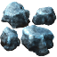 1 Iron Ore,  1 Copper Ore, 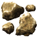 4 Stone | Early, cheap tech; the only way to get bulk Stone out of a Metallic chunk without touching Flurolite research. |
| Carbonic Crushing (Stone-Focused) | 2s |  1 Carbonic Asteroid Chunk |  2 Carbon,  4 Stone | Primary orbital Carbon source; pairs well with Ammonia Extraction's Stone demand. |
| Oxide Crushing (Stone-Focused) | 2s |  1 Oxide Asteroid Chunk |  2 Ice,  4 Stone | Supplements platform ice supply while giving the best Stone-per-chunk of the three common types. |
| Metallic Crushing (Flurolite-Focused) | 3s |  1 Metallic Asteroid Chunk |  1 Iron Ore,  1 Copper Ore,  2 Stone,  5% chance for 1 Flurolite, 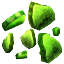 1% chance for 1 Uranium Ore | Advanced independent tech; trades half the Stone yield for trace Flurolite and Uranium Ore rolls. |
| Carbonic Crushing (Flurolite-Focused) | 3s |  1 Carbonic Asteroid Chunk |  2 Carbon,  2 Stone,  5% chance for 1 Flurolite,  1% chance for 1 Uranium Ore | Same Carbon yield, lower Stone, adds Flurolite and Uranium Ore rolls. |
| Oxide Crushing (Flurolite-Focused) | 3s |  1 Oxide Asteroid Chunk |  2 Ice,  2 Stone,  5% chance for 1 Flurolite,  1% chance for 1 Uranium Ore | Same Ice yield, lower Stone, adds Flurolite and Uranium Ore rolls. Calcite is left to the existing non-Flurolite Oxide processing recipe. |
| Shattered Synthesis | 4s |  1 Promethium Asteroid Chunk |  20% chance for 1 Holmium Ore,  1 Tungsten Ore,  2 Stone,  5% chance for 1 Flurolite,  3% chance for 1 Uranium Ore | Most advanced Crusher tech; Red Asteroids provide trace Holmium and other rare byproducts. |

### Cryogenic Plant

| Recipe | Time | Exact Ingredients | Outputs | Notes |
| --- | --- | --- | --- | --- |
| Ammonia Extraction | 5s |  5 Stone,  100 Water,  50 Steam | 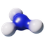 10 Ammonia | Consumes Stone, Water, and Steam in a Cryogenic Plant; no dedicated building needed. |
| Lithium-Focused Condensation | 10s |  1 Flurolite,  100 Steam | 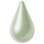 40 Lithium Brine,  10 Fluorine | Pick this variant when Lithium Brine is the limiting product. |
| Fluorine-Focused Condensation | 10s |  1 Flurolite,  100 Steam |  40 Fluorine,  10 Lithium Brine | Mirror recipe of Lithium-Focused; run both in parallel to balance brine vs. gas demand. |

### Growth Facility

| Recipe | Time | Exact Ingredients | Outputs | Notes |
| --- | --- | --- | --- | --- |
| Yumako Cultivation | 60s | 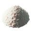 25 Nutrients,  500 Water,  250 Steam,  1 Yumako Seed,  5 Calcite,  10 Carbon,  125 Ammonia |  57 Yumako | Products are preserved while they remain in the machine output, and the facility's tanks show Yumako trees growing while this recipe runs. |
| Jellynut Cultivation | 60s |  25 Nutrients,  500 Water,  250 Steam,  1 Jellynut Seed,  5 Calcite,  10 Carbon,  125 Ammonia |  57 Jellynut | Grown alongside Yumako so the platform can produce both halves of the Bioflux/Nutrients chain without importing either crop. |
| Biter Egg Incubation | 120s |  50 Nutrients,  5 Bioflux,  500 Water,  250 Steam,  1 Biter Egg,  5 Calcite,  10 Carbon,  125 Ammonia |  19 Biter Eggs | Products are preserved in the machine output. Long incubation reflects the difficulty of maintaining a stable oxygenated low-gravity nest environment for a terrestrial nest organism. |
| Pentapod Egg Incubation | 120s |  50 Nutrients,  5 Bioflux,  500 Water,  250 Steam,  1 Pentapod Egg,  5 Calcite,  10 Carbon,  125 Ammonia |  19 Pentapod Eggs | Products are preserved in the machine output. Separate incubation keeps Gleba-native egg biology distinct from Biter egg handling while preserving the same orbital support requirements. |

### Vanilla Recipe Override

| Recipe | Change | Unchanged Behavior |
| --- | --- | --- |
|  Agricultural Science Pack | Removes the vanilla `pressure = 2000` surface condition, permitting crafting in a standard Biochamber on space platforms. | Organic category,  1 Bioflux +  1 Pentapod Egg ingredients, 4s craft time, one-pack output, productivity support, and vanilla technology unlock. |
|  Cryogenic Science Pack | Removes the vanilla `pressure = 300` surface condition, permitting crafting in a standard Cryogenic Plant on space platforms. | Cryogenics category, ingredients, 20s craft time, science-pack and hot Fluoroketone outputs, productivity support, and vanilla technology unlock. |
|  Electromagnetic Science Pack | Removes the vanilla `magnetic-field = 99` surface condition, permitting crafting in a standard Electromagnetic Plant on space platforms. | Electromagnetics category, ingredients, 10s craft time, one-pack output, productivity support, and vanilla technology unlock. |
|  Metallurgic Science Pack | Removes the vanilla `pressure = 4000` surface condition, permitting crafting in a standard Foundry on space platforms. | Metallurgy category,  3 Tungsten Carbide + 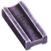 2 Tungsten Plate +  200 Molten Copper ingredients, 10s craft time, one-pack output, productivity support, and vanilla technology unlock. |

## Scientific Justification

- **Ammonia from Stone:** Carbonaceous asteroids contain nitrogen-bearing phyllosilicates. A Cryogenic Plant uses high-pressure and heat processing to extract ammonia directly from stone.
- **Stone from Crushing:** Vanilla asteroid processing never yields Stone, but mechanical shattering of any silicate or metallic body inherently produces mineral rubble regardless of composition. The Stone-Focused Crusher variants isolate that rubble without the finer sieving needed to detect Flurolite traces, which is why they're the cheaper, earlier-tech option.
- **Flurolite Chemistry:** Lithium and fluorine are geochemically linked in evolved crustal granites. Flurolite represents the trace rare-earth inclusions found within shattered planetary crusts, processed through cryogenic plant distillation. Red Asteroids carry the richest concentration, but trace inclusions also turn up in ordinary Metallic, Carbonic, and Oxide chunks; finding them requires the finer sieving of the higher-tier Flurolite-Focused Crusher variants, at the cost of some Stone throughput. Calcite recovery is left untouched on the existing Oxide processing recipe, which already yields it in ample quantity.
- **Uranium Trace Recovery:** Uranium Ore appears as a rare heavy-element inclusion in the same advanced asteroid separation step that detects Flurolite. Common asteroid chunks only expose tiny recoverable traces, while Red Asteroids justify a higher recovery chance because their heavy-metal profile is already represented by Holmium and Tungsten outputs.
- **Growth Facility:** Rather than "stabilizing" life, the Growth Facility provides the precise environmental parameters, including heat, light, nutrients, Bioflux enrichment, nitrogen atmosphere, calcite buffering, carbon feedstock, and high-energy water hydrolysis for oxygen supply, required to maintain planetary species in a low-gravity environment while keeping the high-stakes spoilage mechanics of Space Age intact. Yumako and Jellynut are cultivated from their corresponding seeds as a matched pair, exactly as they grow together on Gleba, while Biter and Pentapod eggs require separate incubation recipes so the platform's Bioflux, Nutrients, and egg chains stay self-sufficient.

## The Endgame Challenge

SPACELAB is not a shortcut past the post-game plateau; it adds new challenges to enjoy beyond it. Success requires balancing an energy grid that can sustain 100 MW Growth Facilities, complete asteroid extraction, and advanced biotech loops while using circuit networks to optimize chemical yields, the same logistics-as-a-puzzle mastery the planets demanded, now applied in orbit.

It is the next milestone for the factory that must grow.

## Asset Attribution

The Growth Facility building graphics (animation, shadow, per-recipe tank contents, and lights), its item icon, and the main layer of its technology icon are original art, rendered from Three.js models in this repository (`tools/sprites/models/growth-facility.js`, `growth-facility-icon.js`, and `growth-facility-technology.js`).

Flurolite uses tinted Space Age calcite icons at runtime, and technology icons layer vanilla item and fluid icons; neither bundles any copied graphics. The item, fluid, building, and technology icons in this README are extracted from Factorio and this mod by `tools/readme-icons.py` and are not part of the mod package.