# Beyond the Edge: Stargate

**Beyond the Edge: Stargate** is a standalone Factorio: Space Age mod. This first version adds the way a gate is built and travel through it, on foot, by vehicle, and by train: one technology (**Experimental Gates**), one craftable 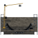 **Stargate Construction Kit**, a `14x14` **Stargate Construction Site** that takes a large delivery of bulk materials, and the **Stargate** itself, which is built there over a minute. Characters, vehicles, and enemies travel between paired gates; trains are planned, see the [vision](VISION.md) and [plan](PLAN.md).

The mod requires `base >= 2.1.0` and `space-age >= 2.1.0`. It has no other dependencies.

Safe to add to an existing late-game save: the mod only adds a technology, a recipe, and three buildings (the site, the gate under construction, and the finished gate).

## A modern gate

The gate is a human-built machine. A segmented steel ring with a dark tungsten core stands upright between two steel support towers that house its electronics and cooling, with ventilator fans, grilles, roof cooling units, and cyan status lights; machinery housings with hydraulic rams and conduits fill the lower corners between the towers and the ring, clamp housings with light bars sit around it, and a glowing emitter line runs along its inner edge. Its power bank lines the west and east walls: two rows of superconducting capacitor cans behind each tower, with ceramic insulators, busbars into the towers, cyan charge bands, and frosted coolant lines from a cryo cooler at the back, and a smaller rack in the front right corner. A control cabinet stands at the front left. The ring is set two tiles forward of the building's centre.

The concrete floor is level with the ground at the border and slopes down into a shallow basin. A trench across the basin, under the ring, holds the ring's lower arc, so the whole ring is visible, while its opening at basin level is wide enough for a train on either lane. The portal is empty for now; bridges and train tracks will cross the trench once train passage exists. The site, the gate under construction, and the finished gate all snap to the same two-tile grid as rails, offset so that the layout across the 14 tiles is four tiles of platform, a lane (2 tiles), a 2-tile gap, a second lane (2 tiles), and four more tiles of platform. The edges of the building fall on rail cell edges, so incoming and outgoing track can be laid flush against it and line up with the lanes.

## Technology

| Technology | Cost | Unlock |
| --- | --- | --- |
|  **Experimental Gates** | `1,000` units at 60 seconds each | Unlocks the  **Stargate Construction Kit** recipe. |

It requires 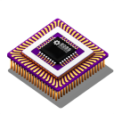 Quantum Processor,  Fusion Reactor, and the Speed, Productivity, Efficiency, and Quality Module 3 technologies. It consumes ten science packs, everything except Military and Promethium:  Automation,  Logistic,  Chemical,  Production,  Utility,  Space,  Metallurgic,  Agricultural,  Electromagnetic, and  Cryogenic. The cost is provisional.

## Stargate Construction Kit

 The **Stargate Construction Kit** carries the scarce high-end parts of a gate, with a little structural material so it is plausibly a kit. It takes `60s` to craft from:

- 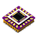 20 Quantum Processors
- 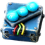 10 Speed Module 3
- 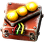 10 Productivity Module 3
- 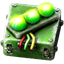 10 Efficiency Module 3
- 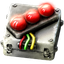 10 Quality Module 3
- 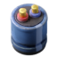 50 Supercapacitors
-  20 Fusion Power Cells
- 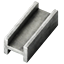 100 Steel Plates
-  100 Refined Concrete
- 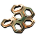 50 Low Density Structures

One kit weighs `1,000 kg`, one cargo rocket load, so the expensive part of a gate travels easily to another planet. Placing it builds a **Stargate Construction Site**. Mining a site returns the kit and everything delivered to it.

## Building a Stargate

The bulk of a gate is delivered to the **Stargate Construction Site**, a `14x14` chest with `32` filtered slots, so it accepts nothing but these materials. Deliver them by hand, with inserters, or from belts. The site needs no power.

| Material | Amount | Slots |
| --- | --- | --- |
| 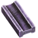 Tungsten Plate | `1,000` | 20 |
|  Superconductor | `200` | 1 |
|  Low Density Structure | `200` | 4 |
|  Refined Concrete | `200` | 2 |
|  Steel Plate | `200` | 2 |
| 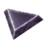 Tungsten Carbide | `100` | 2 |
|  Advanced Circuit | `200` | 1 |

Every amount is a whole number of stacks, so a material's slots hold exactly what a gate needs and a delivery can never overshoot. Nothing is wasted or spilled.

The site checks itself every half second. The moment every slot is full, the delivery is consumed and the site becomes a **Stargate under construction**. Over the next minute the gate goes up in front of you in six equal phases while a progress bar fills across the platform, each adding to the last inside yellow-and-black hazard tape round the perimeter. The first phase keeps the construction site's look (the finished floor, the control cabinet, the front capacitor rack, and the bottom of the ring), so nothing changes the instant the delivery is complete; then come more of the ring and the machinery housings, the towers, the west and then the east capacitor banks, and finally the towers' fans and a whole ring. The tape comes down when the gate is finished. When the bar is full the finished **Stargate** takes its place, keeping its force, quality, and health fraction.

The **Stargate Construction Site** can be mined for a refund of the kit and its delivery. Once the materials are consumed there is no going back: a gate under construction cannot be opened or mined, and a gate that is destroyed, at any stage, leaves no kit and refunds nothing. The finished **Stargate** has `20,000` health, cannot be mined or deconstructed, and is not blueprintable.

## Using a Stargate

A finished **Stargate** carries people between two places. Open it to see its window:

- **Name**: a new gate gets a random name, such as `Abydos-417`. Rename it freely.
- **Paired gate**: pick another gate of your force, on any surface, from the list. Pairing works both ways: the chosen gate is paired back, and any earlier pairs of either gate are broken. If a paired gate is destroyed, its partner is left unpaired. A gate with no partner still opens, and leads somewhere random (below).
- **Enabled**: switches the gate on or off.
- **Enable or disable by circuit condition**: connect a red or green wire to the foot of the west tower and set a condition, as for any machine. The gate stays closed while the condition is false.

You can walk anywhere on a gate except into its machinery (the capacitor banks, towers, and corner cabinets along its west and east sides): through the ring, in front of it, and behind it. While the gate is open, stepping into the ring from either side sends you; while it is closed, you just walk through. Cars, tanks, and spidertron legs are kept out of the machinery the same way.

Each gate runs on its own **power bank**, a `10 GJ` store of capacitors charged from the electric network. It works like the Warp Drive's reserve; [Dynamic Power](../docs/power.md) explains it in full, with charts and formulas.

| | Power |
| --- | --- |
| Store | `10 GJ` of superconducting capacitors, the gate's alone: it powers nothing else and is not shown as accumulator storage |
| Leak | 0.5 % of the charge a second (`50 MW` when full); a store left alone fades to a third in 200 seconds |
| Charging, closed | up to `1.05 GW`: `1 GW` into the store plus the leak; about 10 seconds from empty |
| Opening | needs a full store and spends `8 GJ` of it, leaving `2 GJ` |
| Open | `1 GW` upkeep from the store; draws up to `1.25 GW` (upkeep, leak, and `200 MW` to refill), `1.05 GW` once full again |

A gate that is switched on and allowed by its circuit condition opens once its store is full: the veil forms in its ring with a rush and a shimmer. Right after opening, the `2 GJ` left carries the upkeep for two seconds on its own, and the network refills the store while the gate stays open, in about 37 seconds with enough spare power. If the network cannot keep up, the store drains, and when it runs dry the gate closes and must charge fully before it opens again.

The gate never takes power your factory needs: it asks the network for a little more every tick while it gets everything it asks for, backs off at once when the network falls short, and waits two seconds before asking again, so your machines see at most a brief dip. Several gates on one network share the spare power between them. Like any machine, it is fed by your accumulators when the generators fall short. A full gate fed without a break for five seconds draws its steady need without any script work, and returns to asking tick by tick within a second of a shortage.

The gate's window shows what it draws from the network now, in three lines: keeping the portal open, charging the store, and covering the store's leak.

A gate switched off or closed by its circuit condition stops charging and its store runs down, unless **Keep charged when deactivated** is ticked in its window: then it keeps the store full (`50 MW`) and opens as soon as it is activated again.

The gate's status lights are cyan, and turn red while a switched-on gate charges, or while an open gate gets less than its upkeep. The window shows the charge and why the gate is closed.

The values are provisional, like the rest of the balance.

Walk into the ring of an open gate and you vanish into it with a shimmer heard around the gate: for about two seconds the veil flashes and ripples out from where you went in, while the camera holds on the gate. Then the view moves to the partner gate, where the ripples run backwards for a second with a rising shimmer, closing in on the spot you step out of, and you run five tiles south, clear of it. Your movement keys do nothing until you stop; skipping the cutscene cuts the wait or the run short. Only the sending gate needs power: the receiving gate may be closed, switched off, or unpowered. Everything behind the ring is solid, as are the ring, the towers, and the west and east edges, so you step onto the platform only from the south, and past the ring only through the portal. Nothing can land behind the ring, with a jetpack say, and spidertron legs cannot step there. While the gate is closed the portal is solid too.

Vehicles travel too. Drive a car or tank into the ring (it goes as soon as any part of it touches the portal), or walk a spidertron's body into it, and the vehicle leaves with its driver and passenger still seated and its fuel, ammunition, cargo, and equipment aboard; empty vehicles go just the same, as does a car you jump out of just before the ring and leave rolling in. Driving in at any speed works. A tank or spidertron driven remotely goes too, but its remote driver is put out of it as it enters. The remote view stays where the vehicle went in; movement keys you are still holding will pan it from there. Players riding inside see the same cutscenes as on foot. The vehicle comes out in front of the partner facing south: a car or tank drives five tiles out, a spidertron walks five tiles out, and any autopilot route it had is cleared. Anything that has just come out of a gate is not sent back through it for five seconds, even if the partner is open and a spidertron's body comes down inside its ring. A gate will not send a vehicle to a surface it cannot exist on, such as a car to a surface without gravity; it just stays in the ring.

Biters, spitters, and pentapods that wander into an open ring travel the same way, whatever their force, and come out in front of the partner heading south, so an open gate can bring enemies to your base.

### Train station

Trains travel between two gates that are both set up as train stations. Choose **Train station** in the gate's window:

- **One track, both ways:** a single track along the centre of the gate. Trains leave and arrive on the same track, so a train is not sent here while another stands on it. Two gates whose tracks each hold a train waiting for the other will wait for ever.
- **Two tracks, departures on the right** or **on the left:** one track into the gate and one out of it, two tiles either side of the centre. "Right" means on the right of a train driving into the gate.

The gate then has track running from its south edge up a low ramp, over the ring's lower arc and just into the ring, and an invisible train stop named after the gate beside the departure track at the gate's south edge, so trains wait for the gate at its border. Clicking the gate now opens that stop's own window, with the gate's window beside it. Renaming either one renames both. Connect your rails to the gate's tracks at its south edge. Your own signals go further out, as the gate's machinery and its own hidden signals take up the edge tiles.

A train is sent when its front reaches the gate's edge on the departure track, either because its schedule stops at the gate's station or because you drive it in by hand. The gate must be open, its partner must also be a station, and the way out of the partner must be clear; until then the train waits at the gate's edge in front of the gate's red signal, still on its way to the gate's station. So it never looks for a path to its next stop on the other side, and no "no path" alert is raised. When the gate is ready the signal turns green, and the train is taken as it drives in. Wait conditions on the gate's station therefore never delay a train: use the gate's station as a stop in the schedule, and put waits at the stations before or after it. The train then drives into the ring at 65 km/h, each carriage disappearing once it is wholly behind the veil in a splash of light and sound at its track, and comes out through the veil of the partner's arrival track with the same splash facing the same way it went in, coupled to the carriages before it. Cargo, fluid, fuel, equipment, health, colour, and the driver all come along, and the train pushes out at the same speed. When the last carriage is through, the train gets back its schedule, interrupts, and train group, skips the gate's station, and goes on to its next stop. A train you drove in by hand stays in manual mode and rolls out. Schedule stops that are a rail rather than a named station are dropped, as they belong to the other surface. A remote driver is put out as for vehicles.

Each station gate has an invisible rail signal on its arrival track at its south edge, facing trains that leave, and a visible, gate-controlled one on its departure track for trains heading in, red until the gate can take a train (on a single track, the pair keeps it usable both ways). A train is sent only while the partner's exit signal is green: the block from the gate's edge to your first signal must be free and not reserved. Once a train has started, all of it is sent whatever happens at the other end. Carriages come out as long as there is room; when the part already through stops, at a dead end, a red signal, or another train, every carriage still to come crashes into it and is destroyed with its cargo, and so is any carriage that has not yet come out of the ring (part of it still behind the veil), including the last one sent if the train stops before it is out. Only carriages that have come out survive: with no track beyond the partner at all, that is the locomotive alone. A driver of a destroyed carriage is thrown clear onto the floor beside the arrival track, towards the gate's centre (between the tracks of a two-track gate). So make that first block long enough for your longest train. A gate takes in one train at a time. Once a train has started, it finishes the trip even if the sending gate closes; if either gate is destroyed, the carriages still waiting stay where they are. The station mode cannot be changed while a train is on the gate's rails or passing through.

An open gate with no partner sends you somewhere random: to a planet your force has visited, picked at random (the one you are on included), at the unexplored area closest to that planet's landing site, the nearest chunk your map has not yet charted. There is no gate there: the reversed ripples converge in mid-air on the spot where you appear, and there is no run out. Nothing checks the ground: you may land on an island or by a lake, or among enemies, so bring a jetpack or a way home. A planet counts as visited when your map shows its landing site, as it does once anyone of your force has landed there.

## Balance

All quantities, costs, and the technology are provisional first-experiment values, to be tuned in play. The scarce parts sit in the kit and the bulk in the site, so a gate's expensive core can be shipped by rocket while its bulk is built from local industry. Neither the kit recipe nor the technology needs Promethium science, so a gate does not require a journey to the Solar System Edge.
