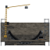
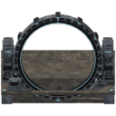
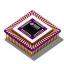
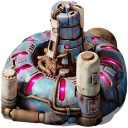
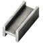
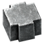
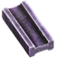
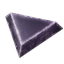

# Beyond the Edge: Stargate

**Beyond the Edge: Stargate** is a standalone Factorio: Space Age mod. This first version adds the way a gate is built: one technology (**Experimental Gates**), one craftable  **Stargate Construction Kit**, a `14x14` **Stargate Construction Site** that takes a large delivery of bulk materials, and the **Stargate** itself, which is built there over a minute. Travel between gates is planned but not implemented yet; see the [vision](VISION.md) and [plan](PLAN.md).

The mod requires `base >= 2.1.0` and `space-age >= 2.1.0`. It has no other dependencies.

Safe to add to an existing late-game save: the mod only adds a technology, a recipe, and three buildings (the site, the gate under construction, and the finished gate).

## A modern gate

The gate is a human-built machine. A segmented steel ring with a dark tungsten core stands upright between two steel support towers that house its electronics and cooling, with ventilator fans, grilles, roof cooling units, and cyan status lights; machinery housings with hydraulic rams and conduits fill the lower corners between the towers and the ring, clamp housings with light bars sit around it, and a glowing emitter line runs along its inner edge. A control cabinet stands at the front left. The ring is set two tiles forward of the building's centre.

The concrete floor is level with the ground at the border and slopes down into a shallow basin. A trench across the basin, under the ring, holds the ring's lower arc, so the whole ring is visible, while its opening at basin level is wide enough for a train on either lane. The portal is empty for now; bridges and train tracks will cross the trench once train passage exists. The site, the gate under construction, and the finished gate all snap to the same two-tile grid as rails, offset so that the layout across the 14 tiles is four tiles of platform, a lane (2 tiles), a 2-tile gap, a second lane (2 tiles), and four more tiles of platform. The edges of the building fall on rail cell edges, so incoming and outgoing track can be laid flush against it and line up with the lanes.

## Technology

| Technology | Cost | Unlock |
| --- | --- | --- |
|  **Experimental Gates** | `1,000` units at 60 seconds each | Unlocks the  **Stargate Construction Kit** recipe. |

It requires  Quantum Processor,  Fusion Reactor, and the Speed, Productivity, Efficiency, and Quality Module 3 technologies. It consumes ten science packs, everything except Military and Promethium:  Automation,  Logistic,  Chemical,  Production,  Utility,  Space,  Metallurgic,  Agricultural,  Electromagnetic, and  Cryogenic. The cost is provisional.

## Stargate Construction Kit

 The **Stargate Construction Kit** carries the scarce high-end parts of a gate, with a little structural material so it is plausibly a kit. It takes `60s` to craft from:

-  20 Quantum Processors
-  10 Speed Module 3
-  10 Productivity Module 3
-  10 Efficiency Module 3
-  10 Quality Module 3
-  50 Supercapacitors
-  20 Fusion Power Cells
-  100 Steel Plates
-  100 Refined Concrete
-  50 Low Density Structures

One kit weighs `1,000 kg`, one cargo rocket load, so the expensive part of a gate travels easily to another planet. Placing it builds a **Stargate Construction Site**. Mining a site returns the kit and everything delivered to it.

## Building a Stargate

The bulk of a gate is delivered to the **Stargate Construction Site**, a `14x14` chest with `32` filtered slots, so it accepts nothing but these materials. Deliver them by hand, with inserters, or from belts. The site needs no power.

| Material | Amount | Slots |
| --- | --- | --- |
|  Tungsten Plate | `1,000` | 20 |
|  Superconductor | `200` | 1 |
|  Low Density Structure | `200` | 4 |
|  Refined Concrete | `200` | 2 |
|  Steel Plate | `200` | 2 |
|  Tungsten Carbide | `100` | 2 |
|  Advanced Circuit | `200` | 1 |

Every amount is a whole number of stacks, so a material's slots hold exactly what a gate needs and a delivery can never overshoot. Nothing is wasted or spilled.

The site checks itself every half second. The moment every slot is full, the delivery is consumed and the site becomes a **Stargate under construction**. Over the next minute the gate goes up in front of you in three equal phases while a progress bar fills across the platform. The first phase keeps the construction site's look (the basin and trench dug in raw concrete, formwork, stacked steel, and a crane mast), so nothing changes the instant the delivery is complete; the second shows the finished floor, the bare steel frames of the towers, and the lower half of the ring; the third adds the tower cladding, the corner housings, and the ring all but its top, with scaffolding at the gap. When the bar is full the finished **Stargate** takes its place, keeping its force, quality, and health fraction.

The **Stargate Construction Site** can be mined for a refund of the kit and its delivery. Once the materials are consumed there is no going back: a gate under construction cannot be opened or mined, and a gate that is destroyed, at any stage, leaves no kit and refunds nothing. The finished **Stargate** has `20,000` health, cannot be mined or deconstructed, and is not blueprintable. It does nothing else yet.

## Balance

All quantities, costs, and the technology are provisional first-experiment values, to be tuned in play. The scarce parts sit in the kit and the bulk in the site, so a gate's expensive core can be shipped by rocket while its bulk is built from local industry. Neither the kit recipe nor the technology needs Promethium science, so a gate does not require a journey to the Solar System Edge.
