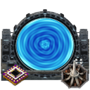
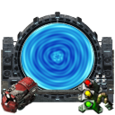
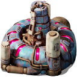
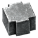
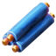

# Beyond the Edge: Stargate

**Beyond the Edge: Stargate** is a standalone Factorio: Space Age mod. It adds a progression from an uncontrolled experimental gate to paired interplanetary gates and train stations: three technologies (**Experimental Gates**, **Controllable Stargate Jumps**, and **Stargate Rail Transit**), one craftable  **Stargate Construction Kit**, a `14x14` **Stargate Construction Site** that takes a large delivery of bulk materials, and the **Stargate** itself, which is built there over a minute. Characters, vehicles, enemies, and trains travel between paired gates; for future campaign integration and optional ideas, see the [plan](PLAN.md).

The mod requires `base >= 2.1.0` and `space-age >= 2.1.0`. It has no other dependencies.

Safe to add to an existing late-game save: the mod only adds three technologies, a recipe, and three buildings (the site, the gate under construction, and the finished gate), and preserves active gate pairings and station lines from earlier saves.

## A modern gate

The gate is a human-built machine. A segmented steel ring with a dark tungsten core stands upright between two steel support towers that house its electronics and cooling, with ventilator fans, grilles, roof cooling units, and cyan status lights; machinery housings with hydraulic rams and conduits fill the lower corners between the towers and the ring, clamp housings with light bars sit around it, and a glowing emitter line runs along its inner edge. Its power bank lines the west and east walls: two rows of superconducting capacitor cans behind each tower, with ceramic insulators, busbars into the towers, cyan charge bands, and frosted coolant lines from a cryo cooler at the back, and a smaller rack in the front right corner. A control cabinet stands at the front left. The ring is set two tiles forward of the building's centre.

The concrete floor is level with the ground at the border and slopes down into a shallow basin. A trench across the basin, under the ring, holds the ring's lower arc, so the whole ring is visible, while its opening at basin level is wide enough for a train on either lane. In station mode, ramped train tracks cross the basin and the trench into the ring. The site, the gate under construction, and the finished gate all snap to the same two-tile grid as rails, offset so that the layout across the 14 tiles is four tiles of platform, a lane (2 tiles), a 2-tile gap, a second lane (2 tiles), and four more tiles of platform. The edges of the building fall on rail cell edges, so incoming and outgoing track can be laid flush against it and line up with the lanes.

## Technologies

| Technology | Cost | Unlock |
| --- | --- | --- |
|  **Experimental Gates** | `1,000` units at 60 seconds each | Unlocks the  **Stargate Construction Kit** recipe. Newly built gates open to uncontrolled random destinations until pairing is researched. |
|  **Controllable Stargate Jumps** | `2,000` units at 60 seconds each | Unlocks **Paired gate** selection so two Stargates of your force can link across any planetary surfaces. It stays greyed out until someone of your force has travelled through an open, unpaired Stargate (on foot or in a vehicle): the experiment comes first. |
|  **Stargate Rail Transit** | `5,000` units at 60 seconds each | Unlocks **Train station** mode (`One track` or `Two tracks`) on Stargates so trains pass between paired stations. |

**Experimental Gates** requires  Quantum Processor,  Fusion Reactor, and the Speed, Productivity, Efficiency, and Quality Module 3 technologies. All three science-pack technologies consume ten packs, everything except Military and Promethium:  Automation,  Logistic,  Chemical,  Production,  Utility,  Space,  Metallurgic,  Agricultural,  Electromagnetic, and  Cryogenic. The costs are provisional.

## Stargate Construction Kit

 The **Stargate Construction Kit** carries the scarce high-end parts of a gate and some of its structure. It takes `60s` to craft from:

-  16 Quantum Processors
-  10 Supercapacitors
-  8 Quality Module 3
-  50 Tungsten Plates
-  100 Refined Concrete
-  50 Superconductors
-  50 Holmium Plates

One kit weighs `1,000 kg`, one cargo rocket load, so the expensive part of a gate travels easily to another planet. Placing it builds a **Stargate Construction Site** on any surface with gravity (`>= 0.1 m/s²`; gates cannot be built on space platforms). Mining a site returns the kit and everything delivered to it.

## Building a Stargate

The bulk of a gate is delivered to the **Stargate Construction Site**, a `14x14` chest with `11` filtered slots, so it accepts nothing but these materials. Deliver them by hand, with inserters, or from belts. The site needs no power.

| Material | Amount | Slots |
| --- | --- | --- |
|  Tungsten Plate | `250` | 5 |
|  Holmium Plate | `300` | 3 |
|  Superconductor | `200` | 1 |
|  Supercapacitor | `200` | 2 |

Every amount is a whole number of stacks, so a material's slots hold exactly what a gate needs and a delivery can never overshoot. Nothing is wasted or spilled.

The site checks itself every half second. The moment every slot is full, the delivery is consumed and the site becomes a **Stargate under construction**. Over the next minute the gate goes up in front of you in six equal phases while a progress bar fills across the platform, each adding to the last inside yellow-and-black hazard tape round the perimeter. The first phase keeps the construction site's look (the finished floor, the control cabinet, the front capacitor rack, and the bottom of the ring), so nothing changes the instant the delivery is complete; then come more of the ring and the machinery housings, the towers, the west and then the east capacitor banks, and finally the towers' fans and a whole ring. The tape comes down when the gate is finished. When the bar is full the finished **Stargate** takes its place, keeping its force, quality, and health fraction.

The **Stargate Construction Site** can be mined for a refund of the kit and its delivery. Once the materials are consumed there is no going back: a gate under construction cannot be opened or mined, and a gate that is destroyed, at any stage, leaves no kit and refunds nothing, only its wrecked platform, which fades after 15 minutes. The finished **Stargate** has `20,000` health, cannot be mined or deconstructed, and is not blueprintable.

## Using a Stargate

A finished **Stargate** carries people between two places. Open it to see its window:

- **Name**: a new gate gets a random name, such as `Abydos-417`. Rename it freely.
- **Paired gate** (unlocked by **Controllable Stargate Jumps**): pick another gate of your force, on any surface, from the list. Pairing works both ways: the chosen gate is paired back, and any earlier pairs of either gate are broken. Pairing cannot be changed while a train is actively passing through an affected gate. If a paired gate is destroyed, its partner is left unpaired. A gate with no partner still opens, and leads somewhere random (below).
- **Engage gate**: switches the gate on or off.
- **Engage when** (shown once a red or green wire is connected to the foot of the west tower): a circuit condition, as on an inserter. Once a signal is chosen, the gate stays closed while the condition is false; with no signal chosen, or with the wires removed, it is ignored.

You can walk anywhere on a gate except into its machinery (the capacitor banks, towers, and corner cabinets along its west and east sides): through the ring, in front of it, and behind it. While the gate is open, stepping into the ring from either side sends you; while it is closed, you just walk through. Cars, tanks, spidertron legs, and ground enemies are kept out of the machinery the same way.

Each gate runs on its own **power bank**, a `10 GJ` store of capacitors charged from the electric network. It works like the Warp Drive's reserve; [Dynamic Power](../docs/power.md) explains it in full, with charts and formulas.

| | Power |
| --- | --- |
| Store | `10 GJ` of superconducting capacitors, the gate's alone: it powers nothing else and is not shown as accumulator storage |
| Leak | 0.5 % of the charge a second (`50 MW` when full); a store left alone fades to a third in 200 seconds |
| Charging, closed | up to `1.05 GW`: `1 GW` into the store plus the leak; about 10 seconds from empty |
| Opening | needs a full store and spends `8 GJ` of it, leaving `2 GJ` |
| Open | `1 GW` upkeep from the store; draws up to `1.25 GW` (upkeep, leak, and `200 MW` to refill), `1.05 GW` once full again |

A gate that is engaged and allowed by its circuit condition opens once its store is full: the veil forms in its ring with a rush and a shimmer. Right after opening, the `2 GJ` left carries the upkeep for two seconds on its own, and the network refills the store while the gate stays open, in about 37 seconds with enough spare power. If the network cannot keep up, the store drains, and when it runs dry the gate closes and must charge fully before it opens again.

The gate never takes power your factory needs: it asks the network for a little more every tick while it gets everything it asks for, backs off at once when the network falls short, and waits two seconds before asking again, so your machines see at most a brief dip. Several gates on one network share the spare power between them. Like any machine, it is fed by your accumulators when the generators fall short. A full gate fed without a break for five seconds draws its steady need without any script work, and returns to asking tick by tick within a second of a shortage.

The gate's window shows what it draws from the network now, in three lines: holding the wormhole open, charging capacitors, and capacitor leakage.

A gate disengaged or closed by its circuit condition stops charging and its store runs down, unless **Keep charged when disengaged** is ticked in its window: then it keeps the store full (`50 MW`) and opens as soon as it is engaged again.

The gate's status lights are cyan, and turn red while a switched-on gate charges, or while an open gate gets less than its upkeep. The window shows the charge and why the gate is closed.

The values are provisional, like the rest of the balance.

Walk into the ring of an open gate and you vanish into it with a shimmer heard around the gate: for about two seconds the veil flashes and ripples out from where you went in, while the camera holds on the gate. Then the view moves to the partner gate, where the ripples run backwards for a second with a rising shimmer, closing in on the spot you step out of, and you run five tiles south, clear of it. Your movement keys do nothing until you stop; skipping the cutscene cuts the wait or the run short. Only the sending gate needs power: the receiving gate may be closed, switched off, or unpowered.

Vehicles travel too. Drive a car or tank into the ring, or walk a spidertron's body into it, and once its centre enters the portal the vehicle leaves with its driver and passenger still seated and its fuel, ammunition, cargo, and equipment aboard; empty vehicles go just the same, as does a car you jump out of just before the ring and leave rolling in. Driving in at any speed or close to the side works. A tank or spidertron driven remotely goes too, but its remote driver is put out of it as it enters. The remote view stays where the vehicle went in; movement keys you are still holding will pan it from there. Players riding inside see the same cutscenes as on foot. The vehicle comes out in front of the partner facing south (or beside the centre track on a single-track station gate): a car or tank drives five tiles out, a spidertron walks five tiles out, and any autopilot route it had is cleared. Anything that has just come out of a gate is not sent back through it for five seconds, even if the partner is open and a spidertron's body comes down inside its ring. A gate will not send a vehicle to a surface whose surface conditions it does not meet; it just stays in the ring.

Biters, spitters, and pentapods that wander into an open ring travel the same way, whatever their force, and come out in front of the partner heading south, so an open gate can bring enemies to your base.

### On Aquilo

Like Aquilo's machines, a gate there freezes unless it is kept warm: it needs `1 MW` of heat from heat pipes beside it, as an assembler needs `100 kW` and a rocket silo `300 kW`. A frozen gate is covered in ice, its lamps are dark, and its window says so: it does not charge (its store leaks away), and it cannot open, so nothing can be sent through it. It still receives travellers and trains from its partner, which needs no power at this end. Once heated it thaws, charges, and opens as usual.

The construction site and the gate under construction keep working in the cold: deliveries are accepted and the build runs its minute. While they are not heated they look frozen too, judged by the same `1 MW` the finished gate will need, so a site that looks warm will give a gate that stays warm.

### Train station

Trains travel between two gates that are both set up as train stations (unlocked by **Stargate Rail Transit**). Choose **Train station** in the gate's window:

- **Single track, bidirectional:** a single track along the centre of the gate. Trains leave and arrive on the same track, so a train is not sent here while another stands on it. Two gates whose tracks each hold a train waiting for the other will wait for ever.
- **Double track, right-hand running** or **left-hand running:** one track into the gate and one out of it, two tiles either side of the centre. Trains keep to the named side: with right-hand running, departures use the track on the right of a train driving into the gate.

The gate window shows the chosen layout under the drop-down: a top-down diagram, with arrows for the direction of travel on each track, and a short explanation beside it.

The gate then has track running from its south edge up a low ramp, over the ring's lower arc and just into the ring, and an invisible train stop named after the gate beside the departure track, behind the ring. Trains brake for it as for any stop, but since it lies beyond the ring they still enter the gate at speed. Clicking the gate now opens that stop's own window, with the gate's window beside it. Renaming either one renames both. Connect your rails to the gate's tracks at its south edge. Your own signals go further out, as the gate's machinery and its own hidden signals take up the edge tiles. Characters, vehicles, and enemies still travel through a station gate, coming out between the two tracks or beside a single track.

The rules for trains:

1. **The entry signal.** A visible signal at the gate's edge on the departure track is green while a train can go through now: the gate is open, its partner is also a station with no other train arriving, and the way out of the partner is free, from the partner's edge to your first signal there. Otherwise it is red, and automatic trains wait in front of it like at any signal. They stay on their way to the gate's station, so they never look for a path on the other side and no "no path" alert is raised. On a single track the partner's way out is the track its own trains come in on, so a train is not sent while another stands there.
2. **Going in.** A train is taken as its front reaches the gate's edge. An automatic train goes whatever has changed since the signal let it in: like any vanilla train, one that has reserved its way through the green signal keeps going even if the signal turns red. A train you drive by hand goes while the gate is open, red signal or not, like running a red signal anywhere; if the way out of the partner is blocked, the crash rules apply.
3. **When it cannot go.** If the partner is not a station or another train is still arriving there, an automatic train stops at the edge and waits until it can go. A train you drive by hand into a closed gate is not taken: it rolls on behind the veil to the end of the track, and goes once the gate opens.
4. **The trip.** The train drives into the ring at the speed it came with and keeps gathering speed as it would on its own (wagons pushed in without a working locomotive move at 65 km/h at least). Each carriage disappears in a splash of light and sound once it is wholly behind the veil and comes out of the partner's arrival track the same way round, coupled to the carriages before it, with its cargo, fluid, fuel, equipment, health, colour, and driver. A remote driver is put out as for vehicles. A gate sends one train at a time. A train long enough to reach another station gate while its tail is still coming out of the first goes on into it at once if that gate would take it anyway (an automatic train whose next stop is that gate, or one driven by hand while that gate is open); the rest keeps coming out of the first gate and follows it through, however many gates in a row. If that gate would not take it, the train stops there and the carriages still coming out of the first gate are wrecked.
5. **Arriving.** An automatic train comes out of the partner at the speed it went in. As soon as its first locomotive facing out is through, it gets back its schedule, interrupts, and train group, skips the gate's station, and drives itself towards its next stop like any train, taking the branches its route needs, while the gate keeps adding the carriages still coming through. Until then (wagons first, or a train pushed in backwards) it is pushed straight out. Schedule stops that are a rail rather than a named station are dropped, as they belong to the other surface. A train you drove in by hand stays in manual mode, is pushed straight out, and rolls on.
6. **Pushed out.** If an arriving train starts to slow down before all of it is through (a red signal, a station, a blocked or broken track, or no path), the gate pushes it straight on, speeding up as the train would, until the last carriage is through or it runs into something. It may miss a branch or run past a red signal, then finds its way again from where it stopped. This gets as many carriages out of the ring as the track has room for.
7. **The gate's station is a waypoint.** Trains are taken at the edge, long before the station behind the ring, so its wait conditions never delay a train: put waits at the stations before or after the gate.
8. **Crashes.** Once a train is taken, all of it is sent, even if the sending gate closes. When the part already through is stopped (the end of the track, or another train in the way), every carriage still to come crashes into it and is destroyed with its cargo, and so is any carriage not yet wholly out of the ring. Only carriages that have come out survive, so the front of the train survives and the rear is lost; with no track beyond the partner at all, only the locomotive is left. The driver of a destroyed carriage is thrown clear onto the floor beside the arrival track, towards the gate's centre. So give each gate a free run beyond it longer than your longest train, and put signals and stations after that: a train pushed past them may otherwise crash into what stands behind them.
9. **Removal.** If either gate is destroyed during a trip, carriages caught on the destroyed gate's own rails are wrecked with it (throwing their drivers clear), while carriages still outside the sender and those already past the partner stay where they are with their schedules. The station mode cannot be changed while a train is on the gate's rails or passing through.

The arrival track has an invisible signal of its own at the gate's edge, which tells the partner whether the way out is free.

When a train with a locomotive only at the head curves into a gate from the left (turning east from south into the northbound approach), Factorio's renderer can jump the remaining wagons along the track by up to two tiles at the moment the locomotive disappears into the ring, because the engine flips which end of the wagon-only remainder counts as its front. Every carriage's real position still moves smoothly and the train arrives whole. Bringing the approach track in straight or from the right avoids the jump, and attaching another locomotive at the rear of the train as well as at the head largely avoids it too.

An open gate with no partner sends you somewhere random: to a planet your force has visited, picked at random (the one you are on included), at the nearest unexplored chunk to that planet's landing site that has solid collision-free ground for you or your vehicle (skipping chunks that are entirely water or lava). Completing your first jump through an unpaired gate (on foot or in a vehicle) makes **Controllable Stargate Jumps** available to research. There is no gate at the destination: the reversed ripples converge in mid-air on the spot where you appear, and there is no run out. Islands, cliffs, and enemies are not filtered out, so bring a jetpack or a way home. A planet counts as visited when your map shows its landing site (or a gate of your force stands on it).

## Balance

All quantities, costs, and the technology are provisional first-experiment values, to be tuned in play. The scarce parts sit in the kit and the bulk in the site, so a gate's expensive core can be shipped by rocket while its bulk is built from local industry. Neither the kit recipe nor the technology needs Promethium science, so a gate does not require a journey to the Solar System Edge.
