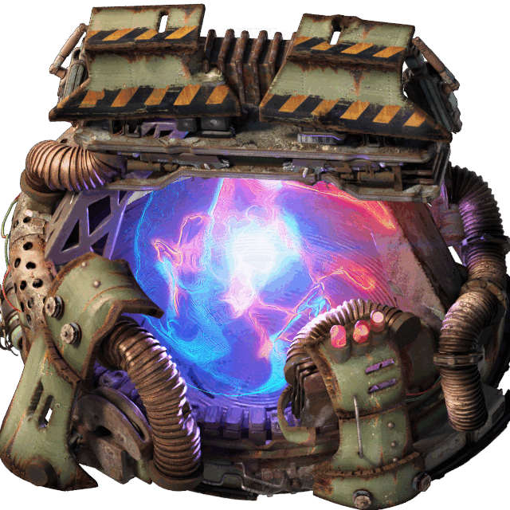

# Factorio Warp Drive Mod

Warp Drive is a standalone Factorio: Space Age post-game mod. It adds one platform-only building and two technologies. The experimental drive detects tachyons to accelerate its own final research; the completed drive provides `100x` travel while preserving normal propulsion, schedules, and route movement.



*The Warp Drive building uses this exact illustration. See [Asset Attribution](#asset-attribution).*

The mod requires `base >= 2.1.0` and `space-age >= 2.1.0`. SPACELAB is optional.

## Why This Mod Exists

The Shattered Planet route is `4,000,000 km` long. Its rising asteroid density turns the post-game into an open-ended platform-engineering challenge, but eventually progress becomes waiting at a rate the factory cannot improve.

Warp Drive makes distance a production input. Deep space becomes the best place to research a technology that removes the travel plateau. The expedition is still a factory problem: a light, well-powered platform detects more tachyons, reaches warp sooner, and travels faster.

Warp is accelerated travel, not teleportation. Thrusters, fuel, weight, power, schedules, and route direction continue to matter. Asteroids vanish in subspace, so speed also cuts off the platform's raw-material supply.

## Design

Warp Drive turns deep-space distance into research output, then turns that research into faster travel. It keeps the challenge factory-driven:

- Research still uses the normal queue, laboratories, and science packs.
- Warp multiplies current engine speed instead of teleporting the platform.
- Charge and support power scale with platform weight.
- Asteroids disappear during warp, so sustained travel interrupts asteroid collection.
- Circuits are optional but can automate warp around platform reserves.

The mod adds no laboratories, science packs, particle items, or separate research pool. Exactly one Warp Drive may be installed per platform.

## Subspace And Tachyons

Subspace Tachyon Particles are transient observations, not resources. They cannot be collected, stored, shipped, or crafted into an item. Their signal strengthens with distance travelled toward the outermost destination in a connected route network.

The experimental Warp Drive is first a detector. Its observations provide bonus research through eligible working laboratories. Where that bonus applies depends on whether all required science packs can be produced in space.

Once Practical Warp Drive is researched, the same building becomes an engine. Warp moves the platform through subspace, where ordinary asteroid chunks do not exist. Departure and arrival still occur in normal space, which is why the first and final `1,000 km` remain conventional travel.

## Research

Before Practical Warp Drive is researched, the drive acts as a detector:

- It consumes up to `200 MW` of surplus platform power. Other powered facilities take priority.
- Partial power proportionally reduces its research bonus.
- The bonus applies only while you are actively researching Practical Warp Drive.
- Labs consume the technology's normal science packs at their normal rate; tachyons add progress without increasing pack consumption.

### Where Research Happens

Warp Drive automatically checks whether every required science pack can be produced on a space platform. It checks available recipes, not installed mod names.

| Available science production | Labs receiving the bonus |
| --- | --- |
| Every required pack can be produced in space | Working labs on the drive's platform only |
| One or more required packs cannot be produced in space | All of your working labs, wherever they are located |

In an unmodded Space Age game, several required science packs cannot be produced in space. The drive therefore relays its observations to all working laboratories, allowing the detector platform to travel while the laboratory base remains at home. If another mod makes every required pack producible in space, only working laboratories on the drive's own platform receive the bonus.

This avoids a dead end: Agricultural Science Packs spoil long before a platform can carry an imported stockpile deep into the final route. When every pack can be produced in orbit, the expedition instead becomes a self-contained research-platform challenge.

### Tachyon Signal

Signal density rises geometrically with kilometres travelled toward the deepest location in the platform's connected route network. Separate route networks are measured independently.

The route-depth ratio $r$ and tachyon density $D$ are:

```math
r = \operatorname{clamp}\left(
  \frac{\ln\left(\max(d, d_{min}) / d_{min}\right)}
       {\ln\left(d_{max} / d_{min}\right)},
  0, 1
\right)
```

```math
D = 10 \left(\frac{2500}{10}\right)^r
```

Here, $d$ is the distance travelled into the route network, $d_{min}$ is its shortest connection, and $d_{max}$ is the full depth to its outermost destination. $D$ is measured in particles per second.

| Position in vanilla | Kilometres flown | Route depth | Density |
| --- | ---: | ---: | ---: |
| Nauvis | `0` | `0%` | `10 particles/s` |
| Vulcanus, Gleba, or Fulgora | `15,000` | `0%` | `10 particles/s` |
| Aquilo | `45,000` | `20%` | `29 particles/s` |
| Solar System Edge | `145,000` | `40%` | `93 particles/s` |
| Halfway through the final route | `2,145,000` | `88%` | `1,308 particles/s` |
| Shattered Planet | `4,145,000` | `100%` | `2,500 particles/s` |

Platform speed and delivered detector power produce the final research multiplier:

```math
S = 1 + \frac{v}{100}
```

```math
M = 1 + \left(D S - 1\right)p
```

Here, $v$ is platform speed in km/s, $p$ is the fraction of the requested detector power delivered from `0` to `1`, and $M$ is the multiplier applied to eligible laboratories. Thus stationary is `1x` speed scaling, `100 km/s` is `2x`, and each additional `100 km/s` adds `1x` with no cap. At maximum density, `100 km/s` and full detector power produce a `5,000 particles/s` signal and `5,000x` research multiplier.

## Warp Travel

After Practical Warp Drive is researched:

- Activation costs `500 J` per kilogram of current platform weight.
- The charge buffer accepts up to `200 MW`, stores up to `100 GJ`, and uses surplus power.
- Automatic engagement requires at least `50 km/s`, sufficient charge, active travel, and more than `1,000 km` clearance from both route endpoints.
- Warp adds `99x` scripted movement to normal movement for `100x` effective speed.
- Active warp consumes `20 W` per kilogram and removes asteroid chunks.
- Warp exits immediately if support power, speed, route eligibility, or automatic engagement is lost.
- Every exit starts a 10-second charge and re-entry lockout.
- The first and final `1,000 km` of each connection use conventional travel. Connections no longer than `2,000 km` cannot use warp.

For a `10,000 tonne` platform, activation requires `5 GJ` and active support requires `200 MW`. Charging at the maximum `200 MW` takes 25 seconds.

The exact mass and speed scaling is:

```math
E_{activation} = m \cdot 500\ \mathrm{J/kg}
```

```math
P_{support} = m \cdot 20\ \mathrm{W/kg}
```

```math
v_{warp} = 100 \cdot v_{engine}
```

```math
t_{charge} = \frac{E_{activation}}{P_{charge}}
```

Here, $m$ is current platform mass in kilograms, $P_{charge}$ is available charge power up to `200 MW`, and $v_{engine}$ is the platform's current engine-derived speed.

## The Endgame Challenge

Warp relocates the post-game problem rather than removing it. A platform in subspace collects no asteroid chunks and eventually starves if it remains there continuously.

The intended solution is an automated cycle: circuits permit warp while reserves are healthy, disengage when they fall, allow collection in normal space, and re-engage after recovery. The drive imposes no resource thresholds, so each platform defines which reserves matter and how low they may fall.

## Controls

Open the drive to view detector power, route progress, platform speed, tachyon rate, eligible labs, research contribution, estimated completion time, charge, support demand, endpoint clearance, cooldown, and engagement settings.

Connect red or green circuit wire near the drive's top-left edge. Circuit engagement requires a positive `E` signal when enabled.

| Output | Value |
| --- | --- |
| `W` | `1` during warp, otherwise `0` |
| `C` | Charge percentage |
| `S` | Effective speed in km/s |
| `P` | Detector power percentage |

## Building And Technologies

The Warp Drive occupies a `6x6` platform footprint and takes 120 seconds to craft from:

- 200 Quantum Processors
- 500 Superconductors
- 1,000 Tungsten Plates
- 500 Carbon Fibers
- 500 Supercapacitors

| Technology | Cost | Unlock |
| --- | --- | --- |
| Theoretical Warp Drive | `10,000` units at 120 seconds each | Experimental detector |
| Practical Warp Drive | `1,000,000,000` units at 120 seconds each | Functional warp travel |

Both technologies use Automation, Logistic, Military, Chemical, Production, Utility, Space, Metallurgic, Electromagnetic, Agricultural, Cryogenic, and Promethium science packs. Practical Warp Drive is intentionally prohibitive without the detector bonus.

## Optional SPACELAB Integration

Warp Drive began as the final chapter of SPACELAB and was split into a standalone mod so subspace research and travel would not require an orbital-industry overhaul. SPACELAB makes platforms self-sufficient; Warp Drive gives them a reason to travel deep into space.

SPACELAB is never required or detected by name. Its orbital science recipes make every required pack producible in space, so the research bonus applies only to working laboratories on the drive's platform. Any mod providing the same capability has the same effect.

## Asset Attribution

The bundled Quantum Stabilizer artwork is by **Hurricane046**. The source post and its Figma resource describe the artwork as free to use; explicit permission has not yet been requested. The creator will be contacted before release.

- <https://mods.factorio.com/user/Hurricane046>
- <https://www.reddit.com/r/factorio/comments/1g6cnhu/ive_been_learning_how_to_make_custom_factorio/>
