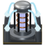
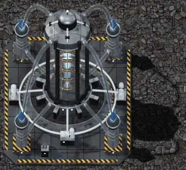
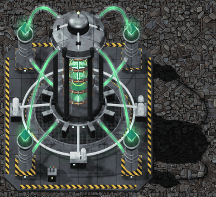
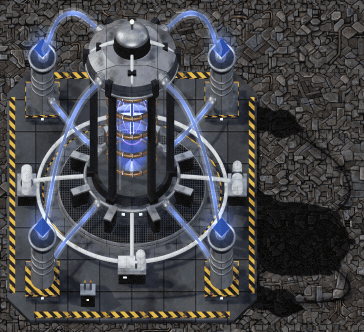
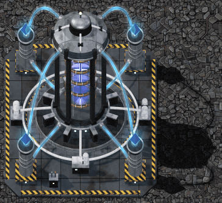
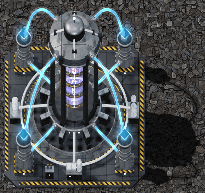
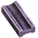
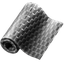
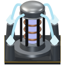
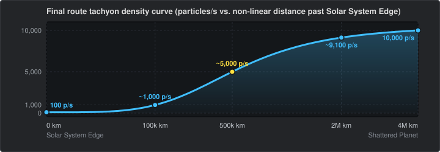

# Beyond the Edge: Warp Drive

**Beyond the Edge: Warp Drive** is a standalone Factorio: Space Age post-game mod. It adds one platform-only building and two technologies: **Theoretical Warp Drive** and **Practical Warp Drive**. Before the final technology is complete, the experimental drive acts as a deep-space tachyon detector that dramatically accelerates its own research; once complete, the same building becomes a warp engine that multiplies platform travel speed and can boost general science when idle.

<!-- Demo video TBD -->

The mod requires `base >= 2.1.0` and `space-age >= 2.1.0`. [Beyond the Edge: Space Lab](../spacelab/README.md) is optional.

## Overview

The Shattered Planet route is `4,000,000 km` long. Its rising asteroid density turns the post-game into an open-ended platform-engineering challenge, but eventually progress becomes waiting at a pace the factory cannot improve.

Warp Drive turns distance into a production input, then turns that research into faster travel:

- **Tachyon research:** Subspace Tachyon Particles are transient observations, not items. Their signal strengthens with distance into deep space and multiplies laboratory progress toward **Practical Warp Drive** using the normal research queue and science packs.
- **Subspace travel:** Warp is accelerated travel, not teleportation. Thrusters, fuel, platform weight, power generation, schedules, and route direction all continue to matter.
- **The resource trade-off:** Asteroids vanish while in subspace, so high speed cuts off the platform's raw-material supply. Sustained deep-space flight becomes an automation puzzle of cycling between warp travel and normal-space asteroid collection.

The mod adds no new laboratories, science packs, or particle items. Exactly one Warp Drive may be installed per space platform.

## Building And Technologies

 **Warp Drive:** An `8x8` platform-only drive core, the same size as the space platform hub. It operates across five stages:

| Standby | Detecting tachyons | Charging |
| --- | --- | --- |
|  |  |  |
| **Activation** | **Warp** | |
|  |  | |

- **Standby:** Idle, switched off, or waiting out the post-warp re-entry lockout; draws no power.
- **Detecting tachyons:** Draws up to `1 GW` of spare platform power to observe subspace tachyons — accelerating **Practical Warp Drive** research before it is completed, or providing the general science boost afterwards while warp is not engaged.
- **Charging:** Fills the internal warp reserve (`100 J/kg` of platform weight, up to `10 W/kg`) once **Engage warp drive** is clicked or the engage circuit condition holds.
- **Activation:** Spends 90% of the charged reserve to breach subspace, retaining 10% as the initial support reserve and sweeping surrounding asteroids off the platform with an outward shockwave.
- **Warp:** Multiplies platform travel speed (`10x` at Warp-1, climbing 1 level every 2 seconds while engine speed and `10 W/kg` per level of support power allow) and suppresses all incoming asteroids until disengaged.

The Warp Drive takes 120 seconds to craft from:

-  200 Quantum Processors
-  500 Superconductors
-  1,000 Tungsten Plates
-  500 Carbon Fibers
-  500 Supercapacitors

| Technology | Cost | Unlock |
| --- | --- | --- |
| <br>**Theoretical Warp Drive** | `10,000` units at 120 seconds each | Unlocks the  **Warp Drive** building in experimental detector mode, allowing platforms to observe deep-space tachyons, accelerate **Practical Warp Drive** research, and automate detector operation via circuit signals (`C` and `T`). |
| <br>**Practical Warp Drive** | `1,000,000,000` units at 120 seconds each | Upgrades every installed **Warp Drive** to full operational mode: unlocks subspace warp travel, warp engage/disengage circuit conditions and telemetry outputs (`W`, `D`, and `S`), and converts the detector into a general science boost (e.g. `+1,500%` for onboard platform labs or `+150%` remotely to planetary labs at `50 km/s` and `1 GW`) while not in warp. |

Both technologies use  Automation,  Logistic,  Military,  Chemical,  Production,  Utility,  Space,  Metallurgic,  Electromagnetic,  Agricultural,  Cryogenic, and  Promethium science packs. **Practical Warp Drive** is intentionally prohibitive without the detector bonus.

## Researching Practical Warp Drive

Before **Practical Warp Drive** is researched, the drive operates as a tachyon detector:

- **Start tachyon detector** and **Stop tachyon detector** (or their circuit conditions) switch detection on and off. New drives start with the detector on; stopping it ends its power draw and research bonus.
- As an ordinary secondary-priority consumer, the detector adaptively requests up to `1 GW` of spare platform power: after a shortfall it drops its request to what was delivered, and when fully supplied it probes `10 MW` higher, so it uses spare generation without starving the ship.
- The bonus applies only while researching **Practical Warp Drive**. Labs consume science packs at their normal rate while tachyons add bonus progress.
- The runtime Map setting **Severely impatient mode** multiplies the tachyon research bonus by `1,000` and takes effect immediately.

### Where Research Happens

While researching **Practical Warp Drive**, each detector checks whether any laboratory buildings exist on its own space platform:

| Laboratories on the drive's platform | Target laboratories | Signal efficiency ($R$) |
| --- | --- | --- |
| At least one laboratory on this platform | Working laboratories on this platform only | **100%** (1x, full local signal) |
| No laboratories on this platform | All of your working laboratories on planets | **10%** (0.1x, 10x remote-transfer loss) |

If your platform has no laboratories of its own, the detector automatically transmits its tachyon telemetry to your planetary laboratories with a **10x remote-transfer data loss**, so you can still complete the research from home without shipping perishable science packs into deep space. Building laboratories directly on the detector platform (and supplying them with science packs, or producing them in orbit with [Beyond the Edge: Space Lab](../spacelab/README.md)) eliminates the transfer loss and delivers the full 100% signal to that ship's laboratories.

### Tachyon Signal

Tachyon density $T$ rises from **10** to **100 particles/s** across the inner solar system, climbs steeply through the first **500,000 km** past the Solar System Edge, and tapers to **10,000 particles/s** at the Shattered Planet:



| Position in vanilla | Kilometres flown | Final stretch | Density ($T$) |
| --- | ---: | ---: | ---: |
| Nauvis, Vulcanus, Gleba, or Fulgora | 0 – 15,000 | — | 10 particles/s |
| Aquilo | 45,000 | — | 30 particles/s |
| Solar System Edge | 145,000 | 0 km | 100 particles/s |
| 100,000 km into the final route | 245,000 | 100,000 km | ~1,000 particles/s |
| 500,000 km into the final route | 645,000 | 500,000 km | ~5,000 particles/s |
| Halfway through the final route | 2,145,000 | 2,000,000 km | ~9,100 particles/s |
| Shattered Planet | 4,145,000 | 4,000,000 km | 10,000 particles/s |

Each eligible laboratory receives a bonus research multiplier $B$ equal to the effective tachyon signal:

```math
B = T \cdot S \cdot P \cdot R
```

| Factor | How it scales | Range |
| --- | --- | --- |
| **Density ($T$)** | Route depth toward the deepest destination | 10 – 10,000 particles/s |
| **Speed ($S$)** | 1x while stationary, plus 1x per 100 km/s of platform speed | 1.5x at 50 km/s, 2x at 100 km/s (uncapped) |
| **Power ($P$)** | 1x per 100 MW of delivered detector power | 0x – 10x (at 1 GW) |
| **Relay ($R$)** | 1x for onboard platform labs, or 0.1x for remote planetary labs | 0.1x or 1x |

*(Enabling **Severely impatient mode** multiplies $B$ by an additional 1,000x.)*

**Example:** At **500,000 km** past the Solar System Edge (~5,000 particles/s), **50 km/s** (1.5x), and **500 MW** (5x), each onboard laboratory receives a **~37,500x** research bonus (or **~3,750x** per planetary laboratory via remote transfer). At the Shattered Planet with **1 GW** and **50 km/s**, the bonus reaches **150,000x** locally (**15,000x** remotely).

## General Science Tachyon Boost

Once **Practical Warp Drive** is researched, the detector can boost any active technology while the drive is not in warp. It uses the exact same effective tachyon signal and laboratory routing, divided by 10,000:

```math
B_{science} = \frac{T \cdot S \cdot P \cdot R}{10000}
```

At the Shattered Planet (**10,000 particles/s**), **50 km/s** (1.5x), and **1 GW** (10x):

- **Onboard platform laboratories ($R = 1$):** Adds **+1,500%** (**16x** research speed) to working laboratories on that platform.
- **Remote planetary transfer ($R = 0.1$):** Adds **+150%** (**2.5x** research speed) to all working planetary laboratories per drive, and multiple remote drives add together.

## Warp Travel

After **Practical Warp Drive** is researched, the drive can propel its platform through subspace:

- **Entry requirements:** The platform must be travelling along a connection (longer than `2,000 km`), more than `1,000 km` from both endpoints, moving at least `50 km/s`, and outside the re-entry lockout.
- **Charging & reserve (`100 J/kg`):** Clicking **Engage warp drive** (or meeting the engage condition) charges the internal warp reserve at up to `10 W/kg` (10 seconds at full power). If any entry requirement is lost during charging, the reserve resets and a 5-second lockout begins.
- **Warp levels & acceleration:** Entry spends 90% of the charge, retains 10% as the initial support reserve, and starts at **Warp-1** (`10x` speed boost). After a brief stabilization pause, the drive climbs by `0.5 levels/s` (1 level every 2 seconds) as long as engine speed and support power permit, with no scripted cap:

```math
L_{target} = \min\left(\frac{v_{engine}}{50\ \mathrm{km/s}},\ \frac{P_{available}}{m \cdot 10\ \mathrm{W/kg}}\right), \qquad v_{subspace} = 10 \cdot L_{current} \cdot v_{engine}
```

  Each warp level requires `50 km/s` of engine speed and `10 W/kg` of support power (plus up to `10 W/kg` of surplus power to replenish the support reserve back to 100%). Reaching **Warp-10** (`100x` speed) therefore requires `500 km/s`, `100 W/kg`, and about 18 seconds after stabilization.
- **Worked example (`10,000 tonne` platform):** The reserve holds `1 GJ`, charging requests up to `100 MW` for 10 seconds, entry retains `100 MJ`, and replenishment restores the remaining `900 MJ` over 9 seconds. Sustaining Warp-1 needs `100 MW`; Warp-2 needs `200 MW`.
- **Brownouts & low speed:** If engine speed drops below a level's requirement, the warp level drops immediately; falling below `50 km/s` starts a 5-second warning before warp exits. If power falls short, the drive holds its current level by draining the support reserve (bridging up to 1 second of total outage right after entry, or 10 seconds once replenished to 100%).
- **Disengaging & lockout:** Each engagement is a single jump. Warp exits on **Disengage**, the disengage condition, reaching the final `1,000 km` endpoint zone, depletion of the support reserve, or 5 seconds below `50 km/s`, then enters a 10-second re-entry lockout.
- **Subspace environment:** Entering warp sends an azure-and-violet shockwave across the platform that sweeps away existing asteroids, and no new asteroids appear until warp ends. Electric-blue streaks, slow-drifting pastel anomalies, and harmless local lightning surround the ship, accompanied by a rising capacitor whine, dimensional breach roar, and subspace hum on the game-effects volume slider.

## Controls & Circuit Network

Opening the Warp Drive shows a persistent status header and three tabs:

- **Header:** Live camera view of the drive, current status or blocker, route and remaining distance, effective speed and ETA, and the main action buttons (**Start/Stop tachyon detector** before **Practical Warp Drive**; **Engage/Disengage** after). While warp is active, the platform's name also appends a cyan tag such as `WARP-2.4` so it is visible on the space map.
- **Warp:** Entry requirement checklist, live warp-field metrics (reserve charge, outage cover, current vs. achievable warp level, power, and ramp state), and the engage/disengage circuit conditions.
- **Tachyon Detector** (renamed **Science Boost** after **Practical Warp Drive**): Current tachyon density, a non-linear final-route density line chart (`Edge` to `4M km`) highlighting the platform's current position, speed and power signal multipliers, onboard vs. remote-transfer routing status, research progress and ETA (or general Science Boost controls after **Practical Warp Drive**), and the detector start/stop conditions. Hovering ⓘ shows the formula summary.
- **Signals:** Connected Red and Green circuit network summaries with their live signal values displayed directly on the panel, alongside configurable output signals.

### Circuit Conditions & Outputs

Connect red or green wire to the terminal near the drive's top-left corner. Conditions read the sum of both networks, show a green indicator dot while true, and copy via blueprints or settings paste:

| Condition | Behavior while true |
| --- | --- |
| **Engage if condition** | Engages whenever all entry requirements are met. Turning false does not disengage. |
| **Disengage if condition** | Abandons charging or exits warp, and overrides the engage condition. |
| **Start detector / boost if condition** | Switches the detector on; it stays on afterwards until stopped. |
| **Stop detector / boost if condition** | Switches the detector off and overrides the start condition. |

To automate a long expedition, set **Engage** when fuel/ammo reserves are high (e.g. `> 80%`) and **Disengage** when they run low (e.g. `< 20%`) so the platform pauses in normal space to harvest asteroids before jumping again.

All five circuit outputs can be toggled individually and reassigned to any signal (`W`, `D`, and `S` unlock with **Practical Warp Drive**; `D` and `T` are opt-in by default):

| Default | Output value |
| --- | --- |
| `W` | Completed integer warp level while engaged, otherwise `0` |
| `D` | Whole kilometres remaining to the current connection destination |
| `C` | Warp support reserve percentage (`0`–`100`) |
| `S` | Effective travel speed in whole km/s |
| `T` | Whole tachyon particles per second at the current route depth |

## Asset Attribution

The Warp Drive building graphics (hull, shadow, status lamps, and the per-state core overlays), its item icon, and its technology icon are original art, rendered from Three.js models in this repository (`tools/sprites/models/warp-drive.js`, `warp-drive-icon.js`, and `warp-drive-technology.js`). The warp effects (the activation shockwave, the lightning's cloud, the background anomalies, and the subspace streaks) are original art from `tools/sprites/models/warp-field.js`. The lightning bolts themselves are drawn by the game from a harmless copy of Space Age's Fulgora lightning prototype, without copying its graphics. The sounds are synthesized locally; see [`AUDIO.md`](AUDIO.md). README GIFs and icons are generated too; `AGENTS.md` lists every generator.

The item and technology icons in this README are extracted from Factorio and this mod by `tools/readme-icons.py`, and the final-route tachyon density chart is generated by `tools/tachyon-chart.py`; neither is part of the mod package.
