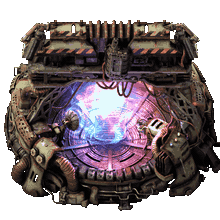

# Factorio Warp Drive Mod

Warp Drive is a standalone Factorio: Space Age post-game mod. It adds one platform-only building and two technologies. The experimental drive detects tachyons to accelerate its own final research; the completed drive emulates subspace travel with a speed boost derived from active engine thrust.



*The Warp Drive building uses this exact illustration. See [Asset Attribution](#asset-attribution).*

The mod requires `base >= 2.1.0` and `space-age >= 2.1.0`. SPACELAB is optional.

## Why This Mod Exists

The Shattered Planet route is `4,000,000 km` long. Its rising asteroid density turns the post-game into an open-ended platform-engineering challenge, but eventually progress becomes waiting at a rate the factory cannot improve.

Warp Drive makes distance a production input. Deep space becomes the best place to research a technology that removes the travel plateau. The expedition is still a factory problem: a light, well-powered platform detects more tachyons, reaches warp sooner, and travels faster.

Warp is accelerated travel, not teleportation. Entering subspace starts at Warp-1 and a `10x` effective speed boost. After support power stabilizes, the drive accelerates through approximately one additional warp level every 2 seconds while engine thrust and support power permit. Thrusters, fuel, weight, power, schedules, and route direction all continue to matter. Asteroids vanish in subspace, so speed also cuts off the platform's raw-material supply.

## Design

### Standard-Grid Electricity

Warp Drive is an ordinary secondary-priority consumer, like most platform machines. It requests its current detector, charging, or support demand directly from the platform grid. During a generation shortfall, Factorio shares available power proportionally with other secondary consumers; the drive measures what it actually receives. In research mode, it lowers detector demand to delivered power after a shortfall and probes for another `10 MW` when fully supplied, converging on spare generation instead of continuously starving other machines. Its script-owned support reserve covers a warp shortfall until depleted, then exits warp safely.

Warp Drive otherwise turns deep-space distance into research output, then turns that research into faster travel. It keeps the challenge factory-driven:

- Research still uses the normal queue, laboratories, and science packs.
- Engine thrust sets the maximum warp level; reaching it takes time and sufficient power.
- Charge scales with platform weight; support power scales with both weight and warp level.
- Asteroids disappear during warp, so sustained travel interrupts asteroid collection.
- Circuits are optional but can automate warp around platform reserves.

The mod adds no laboratories, science packs, particle items, or separate research pool. Exactly one Warp Drive may be installed per platform.

## Subspace And Tachyons

Subspace Tachyon Particles are transient observations, not resources. They cannot be collected, stored, shipped, or crafted into an item. Their signal strengthens with distance travelled toward the outermost destination in a connected route network.

The experimental Warp Drive is first a detector. Its observations provide bonus research through eligible working laboratories. Where that bonus applies depends on whether all required science packs can be produced in space.

Once Practical Warp Drive is researched, the same building becomes an engine. Warp moves the platform through subspace, where ordinary asteroid chunks do not exist. Departure and arrival still occur in normal space, which is why the first and final `1,000 km` remain conventional travel.

## Research

Before Practical Warp Drive is researched, the drive acts as a detector:

- Detection can run continuously or only while a configured circuit condition is true. Disabling both controls stops its power draw and research contribution.
- It adaptively requests up to `1 GW` from the platform grid as an ordinary secondary-priority consumer. A shortfall lowers its next request to delivered power; full delivery makes it probe `10 MW` higher.
- `200 MW` preserves the base detector rate; each additional `200 MW` adds another full power factor, up to `5x` at `1 GW`.
- Partial power scales its research bonus continuously.
- The bonus applies only while you are actively researching Practical Warp Drive.
- Labs consume the technology's normal science packs at their normal rate; tachyons add progress without increasing pack consumption.
- The runtime Map setting **Severely impatient mode** multiplies the tachyon research bonus by `1,000`. It is for severely impatient people and takes effect immediately without restarting the game.

### Where Research Happens

Warp Drive automatically checks whether every required science pack can be produced on a space platform. It checks available recipes, not installed mod names.

| Available science production | Labs receiving the bonus |
| --- | --- |
| Every required pack can be produced in space | Working labs on the drive's platform only |
| One or more required packs cannot be produced in space | All of your working labs, wherever they are located |

In an unmodded Space Age game, several required science packs cannot be produced in space. The drive therefore relays its observations to all working laboratories, allowing the detector platform to travel while the laboratory base remains at home. If another mod makes every required pack producible in space, only working laboratories on the drive's own platform receive the bonus.

This avoids a dead end: Agricultural Science Packs spoil long before a platform can carry an imported stockpile deep into the final route. When every pack can be produced in orbit, the expedition instead becomes a self-contained research-platform challenge.

### Tachyon Signal

Signal density rises geometrically with kilometres travelled toward the deepest location in the platform's connected route network. Separate route networks are measured independently.

The route-depth ratio $r$ and tachyon density $D$ are:

```math
r = \operatorname{clamp}\left(
  \frac{\ln\left(\max(d, d_{min}) / d_{min}\right)}
       {\ln\left(d_{max} / d_{min}\right)},
  0, 1
\right)
```

```math
D = 20 \left(\frac{10000}{20}\right)^r
```

Here, $d$ is the distance travelled into the route network, $d_{min}$ is its shortest connection, and $d_{max}$ is the full depth to its outermost destination. $D$ is measured in particles per second.

| Position in vanilla | Kilometres flown | Route depth | Density |
| --- | ---: | ---: | ---: |
| Nauvis | `0` | `0%` | `20 particles/s` |
| Vulcanus, Gleba, or Fulgora | `15,000` | `0%` | `20 particles/s` |
| Aquilo | `45,000` | `20%` | `67 particles/s` |
| Solar System Edge | `145,000` | `40%` | `246 particles/s` |
| Halfway through the final route | `2,145,000` | `88%` | `4,828 particles/s` |
| Shattered Planet | `4,145,000` | `100%` | `10,000 particles/s` |

Platform speed and delivered detector power produce the final research multiplier:

```math
S = 1 + \frac{v}{100}
```

```math
P = \operatorname{clamp}\left(\frac{P_{delivered}}{200\ \mathrm{MW}}, 0, 5\right)
```

```math
B = D S P I
```

Here, $v$ is platform speed in km/s, $P_{delivered}$ is delivered detector power, $I$ is `1` normally or `1,000` in Severely impatient mode, and $B$ is the bonus multiplier added on top of each eligible laboratory's ordinary research. Thus stationary is `1x` speed scaling, `100 km/s` is `2x`, and each additional `100 km/s` adds `1x` with no cap. At maximum density and `100 km/s`, `200 MW` adds approximately `20,000x` bonus research while `1 GW` adds approximately `100,000x` before the optional impatient multiplier.

For example, without an additional SPACELAB facility bonus, `300,000 km` toward Shattered Planet gives approximately `549 particles/s` of tachyon density. At `50 km/s`, the speed multiplier is `1.5x`; at `500 MW`, the power multiplier is `2.5x`. The resulting effective signal is approximately `2,057 particles/s`, so every eligible laboratory adds about `2,057x` its ordinary rate as bonus research.

## Warp Travel

After Practical Warp Drive is researched:

- The warp support reserve stores `100 J` per kilogram of current platform weight.
- Charging and active warp are ordinary secondary-priority loads. During a brownout they share available power proportionally with most platform machines. Reserve replenishment is capped at the same `10 W/kg` charging rate.
- The reserve charges only after control, minimum speed, active travel, endpoint clearance, and cooldown requirements are all satisfied. Losing any prerequisite after the audible buildup begins resets it to zero, plays a matching power-down sound, and starts a 5-second re-entry lockout, so charging must complete in one uninterrupted cycle.
- Delivered charging power is transferred into an exact, script-owned mass-scaled reserve. The hidden consumer cannot output that private reserve back to the ship network and is not classified as accumulator storage.
- Automatic engagement requires at least `50 km/s`, sufficient charge, active travel, and more than `1,000 km` clearance from both route endpoints.
- Subspace travel always begins at Warp-1, applying a `10x` boost.
- Warp entry spends 90% of the activation charge and retains the remaining 10% as the initial support reserve. Delivered power beyond active support demand replenishes it toward 100% during warp.
- After a brief support-power stabilization interval, the drive gains approximately one warp level every 2 seconds. Each level requires another `50 km/s` of engine speed and `10 W/kg` of support power.
- Warp-10 therefore requires at least `500 km/s`, provides a `100x` boost, and takes approximately 18 seconds to reach from Warp-1 after stabilization.
- Warp level has no scripted maximum; Factorio's platform physics and the increasing power demand provide the limits.
- The drive compares delivered power with the next fractional level's support demand before accelerating into it.
- Lost engine speed lowers sustainable warp levels immediately. Falling below the minimum `50 km/s` starts a prominent 5-second exit warning; restoring speed during that grace period keeps Warp-1 engaged. If power falls below the current level's support demand, the drive holds that level and drains its warp support reserve in proportion to the shortfall. A complete outage lasts 1 second immediately after entry or 10 seconds after the reserve replenishes to full.
- When entry conditions become ready, a synthesized "Engage warp drive!" command plays once before charging rises through a 20-step machinery hum. Warp activation hands off to a continuous two-part subspace ambience, and exit plays a distinct deactivation implosion.
- Warp removes asteroid chunks and large asteroids while active and renders cyan subspace streaks plus harmless Fulgora-style lightning at randomized positions and times across the platform and 64 tiles into nearby space.
- Warp exits immediately if its selected control mode is disabled, its circuit condition becomes false, or route eligibility is lost. Minimum engine speed has the 5-second grace period above; support failure exits when the warp support reserve is depleted.
- Every active-warp exit starts a 10-second charge and re-entry lockout; interrupted activation uses the same lockout mechanism for 5 seconds.
- The first and final `1,000 km` of each connection use conventional travel. Connections no longer than `2,000 km` cannot use warp.

For a `10,000 tonne` platform, the warp support reserve holds `1 GJ`, charging requests up to `100 MW` and takes 10 seconds at full power, entry retains `100 MJ`, and active replenishment restores the missing 90% in 9 seconds at that rate. Support is capped at `100 MW` at Warp-1 and `200 MW` at Warp-2, before the separate replenishment allowance.

Factorio reports runtime platform weight directly in kilograms. The drive uses that value without the data-stage gram conversion, so reserve and support requirements scale against the full displayed platform mass.

The exact mass and speed scaling is:

```math
E_{activation} = m \cdot 100\ \mathrm{J/kg}
```

```math
L_{engine} = \frac{v_{engine}}{50\ \mathrm{km/s}}
```

```math
L_{power} = \frac{P_{available}}{m \cdot 10\ \mathrm{W/kg}}
```

```math
L_{target} = \min(L_{engine}, L_{power})
```

```math
B = 10L_{current}
```

```math
P_{support} = m \cdot 10\ \mathrm{W/kg} \cdot L_{requested}
```

```math
v_{subspace} = B \cdot v_{engine}
```

```math
t_{charge} = \frac{E_{activation}}{P_{charge}}
```

Here, $m$ is current platform mass in kilograms, $L_{current}$ is the continuous active warp level, $L_{requested}$ is the next small acceleration step, $B$ is the effective speed boost, $P_{available}$ is delivered support power, $P_{charge}$ is delivered charging power, and $v_{engine}$ is the platform's current engine-derived speed. Entry sets $L_{current}=1$ and spends 90% of the activation charge. After support demand is met, up to `10 W/kg` of additional delivered power replenishes the reserve toward 100%. The level rises at `0.5 levels/s` while engine speed and power permit. If delivery falls below 99.9% of current-level demand, the reserve holds that level and bridges a complete outage for up to 10 seconds when full; neither the level nor boost has a scripted upper limit.

## The Endgame Challenge

Warp relocates the post-game problem rather than removing it. A platform in subspace collects no asteroid chunks and eventually starves if it remains there continuously.

The intended solution is an automated cycle: circuits permit warp while reserves are healthy, disengage when they fall, allow collection in normal space, and re-engage after recovery. The drive imposes no resource thresholds, so each platform defines which reserves matter and how low they may fall.

## Controls

Open the drive to see its current mode prominently at the top: warp, charging, idle, or locked. A live checklist uses green for satisfied conditions, orange for transitional states, red for threats or blockers, and grey when control is disabled. It reports control, destination, endpoint clearance, re-entry lockout, reserve charge, total Warp Drive power consumption, engine-derived platform speed, and acceleration. Current position includes distance remaining to the destination; blocked endpoint clearance identifies the nearest endpoint. While preparing to jump, Warp status becomes a charging progress bar. The main panel also shows detector power, route progress, tachyon rate, research contribution, warp level, boost, and effective platform speed; circuit controls and outputs occupy a narrow right panel.

Choose either continuous/manual control or circuit control in the drive window. Before Practical research, those controls enable tachyon detection continuously or only while the circuit condition is true. After Practical research, the reserve begins charging only after control, speed, active travel, endpoint clearance, and cooldown requirements permit, making charge the final requirement before warp entry. Losing any prerequisite before entry resets partial charge to zero. Circuit control disables continuous/automatic control; an incomplete or false condition stops detection in research mode, or resets preparation and exits active warp in practical mode. Clearing both controls likewise disables the current mode. Connect red or green circuit wire near the drive's top-left edge, then choose a signal, comparator, and either an integer threshold or second signal. No engagement signal is selected by default, and right-clicking the signal clears it. Signals from the red and green networks are summed, matching ordinary circuit-controlled entities.

All circuit outputs are independently enabled and can use any signal. `W` and `S` are hidden and suppressed until Practical research; `T` is available only during research mode. Existing practical outputs remain enabled by default; remaining distance and tachyon density are opt-in.

| Default | Value |
| --- | --- |
| `W` | Completed integer warp level while engaged, otherwise `0` |
| `D` | Whole kilometres remaining to the current connection destination |
| `C` | Warp support reserve percentage from `0` to `100` |
| `S` | Effective subspace speed in whole km/s |
| `T` | Whole tachyon particles per second at the current route depth; available only before Practical Warp Drive is researched |

## Building And Technologies

The Warp Drive occupies a `6x6` platform footprint and takes 120 seconds to craft from:

- 200 Quantum Processors
- 500 Superconductors
- 1,000 Tungsten Plates
- 500 Carbon Fibers
- 500 Supercapacitors

| Technology | Cost | Unlock |
| --- | --- | --- |
| Theoretical Warp Drive | `10,000` units at 120 seconds each | Experimental detector |
| Practical Warp Drive | `1,000,000,000` units at 120 seconds each | Functional warp travel |

Both technologies use Automation, Logistic, Military, Chemical, Production, Utility, Space, Metallurgic, Electromagnetic, Agricultural, Cryogenic, and Promethium science packs. Practical Warp Drive is intentionally prohibitive without the detector bonus.

## Optional SPACELAB Integration

Warp Drive began as the final chapter of SPACELAB and was split into a standalone mod so subspace research and travel would not require an orbital-industry overhaul. SPACELAB makes platforms self-sufficient; Warp Drive gives them a reason to travel deep into space.

SPACELAB is never required or detected by name. Its orbital science recipes make every required pack producible in space, so the research bonus applies only to working laboratories on the drive's platform. Any mod providing the same capability has the same effect.

## Asset Attribution

The bundled Quantum Stabilizer artwork is by **Hurricane046**. The source post and its Figma resource describe the artwork as free to use; explicit permission has not yet been requested. The creator will be contacted before release.

| Link | Description |
| --- | --- |
| [Hurricane046 on Factorio Mods](https://mods.factorio.com/user/Hurricane046) | Artist profile and published Factorio mods |
| [Original Reddit post](https://www.reddit.com/r/factorio/comments/1g6cnhu/ive_been_learning_how_to_make_custom_factorio/) | Source post introducing the custom building artwork |
| [Factorio Buildings on Figma](https://www.figma.com/proto/y1IQG08ZG2jIeJ5sTyF4MP/Factorio-Buildings) | Showcase of the artist's Factorio building artwork |
